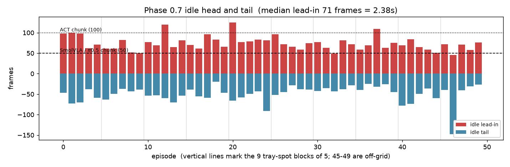
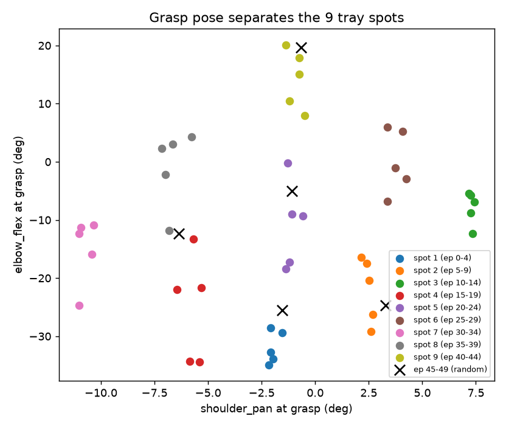

# Phase 0.7 — data verification: is the portable-rig dataset fit to train on?

Stage 1 of the multi-policy comparison (ACT / SmolVLA / π0.5). Verifies the 50 D0 episodes recorded on
2026-10-03 against the **Integrity** row of [08 §A.3](../08_data_quality_research.md) — the checks that
*filter* rather than rank. Run 2026-10-04 on the Windows laptop in the `lerobot` conda env.

Dataset: [`HALDijkstraaa/so101_tray_cylinder_portable_20261003_211912`](https://huggingface.co/datasets/HALDijkstraaa/so101_tray_cylinder_portable_20261003_211912)
(private, `v3.0`, 50 episodes / 35,141 frames / 839 MB) · Script:
[`scripts/verify_phase07_dataset.py`](../scripts/verify_phase07_dataset.py) · Raw output:
[`results/phase07_verification/`](../results/phase07_verification/) · Rig: [phase07_portable_rig.md](phase07_portable_rig.md)

```bash
python scripts/verify_phase07_dataset.py
```

---

# Verdict

**48 PASS · 7 WARN · 0 BLOCK — ready to train, on the trimmed copy.**

Nothing in the recording is broken. No dropped frames, no decode errors, no frozen frames, no exposure
or mount drift, no joint saturation, one clean grasp per episode, and the whole lerobot training path
(both action-chunk sizes, the language string, random-access decode) works end to end. The seven WARNs
are two real collection issues and five explained-benign observations; **one of them — the idle lead-in —
is the reason training must use the trimmed copy rather than this dataset directly.**

| | Status |
|---|---|
| Recording integrity | ✅ clean on every check |
| Train on it as-is | ❌ — the 2.4 s idle lead-in reproduces the Phase 0.6 stall, and worse for the VLAs |
| Train on the idle-trimmed copy | ✅ |
| Comparable to Phase 0.5 / 0.6 | ❌ by design (new calibration frame, new camera pose, new task) |

---

# 1 — What passed

**Manifest and timing (13 checks).** `info.json`, the episodes table and the frame parquet agree exactly:
50 episodes, 35,141 frames, episode slices tile the frame table with no gap or overlap, global index
contiguous. Every episode's `frame_index` runs 0..n−1 and its timestamps start at 0. The worst
inter-frame interval error across all 50 episodes is **0.0014 ms** against a 33.33 ms nominal — three
orders of magnitude inside lerobot's `tolerance_s=1e-4`. **Zero dropped frames.** The `v3.0` tag is on
the Hub (without it lerobot refuses to load the dataset several minutes into a run), and `stats.json`
carries `q01`/`q99`, which π0.5 needs because it normalizes state and action by quantiles.

**Video layout (6 checks).** Episodes sit back-to-back inside each video file with a worst
inter-episode timestamp gap of 0.000 ms, and each file's timestamp span matches its frame count to
0.000 ms. `top` is split across 3 files, `wrist` across 2 (the 200 MB file-size limit).

**Every frame decoded (6 checks).** All 35,141 frames of *both* cameras were decoded sequentially — not
sampled — at ~150 frame/s, and the decoded count matches the parquet row count exactly for each camera.
No decode errors, no row without a frame.

**Image quality (8 checks).** No black, blown-out or featureless frames in either camera. No frozen-frame
runs. Exposure is stable across the session: the `top` camera's per-episode mean luminance spans just
**1.5 grey levels** over the whole 50-episode session (144.5–146.0), `wrist` 7.9. The mount did not move:
every episode's mean image correlates 0.986–1.000 (`top`) with episode 0's, with zero block-level shift.

**Joints (4 checks).** The follower stays inside its calibrated travel everywhere except `elbow_flex` by
**1 encoder count (0.09°)**, which is rounding at the limit. Leader–follower tracking error is ordinary
teleop lag (p99 of 2.7–15.0° depending on joint).

**Task structure (5 checks).** Exactly **one grasp per episode in all 50** — no regrasp (worst re-open
19% of the gripper's opening, well below a let-go) and **no gripper chatter** (median 1 direction change
between grasp and seated). The fixture did not move: `shoulder_pan` at the seated moment has a standard
deviation of **0.39°** across all 50 episodes.

**The real training path (4 checks).** `LeRobotDataset` random access returns CHW float32 in [0,1] for
both cameras; the language string reaches the item (SmolVLA and π0.5 condition on it); and
`delta_timestamps` resolves both an **ACT 100-step chunk** and a **SmolVLA / π0.5 50-step chunk** with no
NaN on the shortest episodes.

---

# 2 — The one thing that blocks training as-is: the idle lead-in



**Phase 0.7 §8 asked for "start moving the instant the episode starts". It did not land.**

| | Phase 0.5 | **Phase 0.7** |
|---|---|---|
| Median lead-in before first motion | 74 frames | **71 frames (2.38 s)** |
| Episodes idle > 25 frames | 50/50 | **50/50** |
| Episodes idle > 50 frames | — | **47/50** |
| Median tail after last motion | — | 45 frames (1.50 s) |

This is the defect Phase 0.6 traced to the rollout stall
([phase06 §4a](phase06_camera_ablation_training.md)): the policy sits at the home pose, predicts a chunk
that *begins with "stay still"*, executes it, re-observes an unchanged scene, and predicts idle again.

**It is worse for this comparison than it was for ACT**, and that is the new argument:

- ACT escaped it only by using the full `n_action_steps=100` — 3.33 s, just longer than the lead-in.
- **SmolVLA and π0.5 both have `chunk_size = 50`**, fixed by their pretrained action experts — 1.67 s.
  Changing it would change the action head's output dimension and break loading the pretrained weights,
  so the ACT escape hatch does not exist for them.
- **47 of 50 episodes have a lead-in longer than one 50-step chunk.** Trained untrimmed, both VLAs would
  learn that the correct first chunk from the home pose is "do nothing", with no larger chunk available
  to clear it.

Only 3/50 episodes exceed an ACT 100-step chunk, so ACT would again mostly survive — but training the
three policies on different data would defeat the point of the comparison.

**Trimming** with the `dev > 2.0°` rule already in [`scripts/make_trimmed_dataset.py`](../scripts/make_trimmed_dataset.py)
keeps **29,462 / 35,141 frames (83.8%)**, leaving episodes of 485–743 frames — every one still longer than
an ACT 100-step chunk. (Phase 0.5's trimmed copy kept 84.8%, so this is the same operation at the same
scale.)

> **For the next collection round.** The instruction did not change behaviour, so it probably needs a
> mechanism rather than a reminder — e.g. have the cylinder already in hand-reach position and begin the
> leader motion before pressing record, or trim at record time. Two rounds have now produced a ~2.4 s
> lead-in from the same instruction.

---

# 3 — Why `shoulder_lift` reads −103.8 at the home pose

This looked like a joint-limit violation. **It is not. It is a unit misreading, and the calibration is good.**

**The mechanism.** lerobot's SO-101 config defaults to `use_degrees=True`
(`robots/so_follower/config_so_follower.py:42`), so the five body joints are recorded in
`MotorNormMode.DEGREES`, not as a ±100 percentage:

```python
mid = (range_min + range_max) / 2
value = (raw_count - mid) * 360 / 4095        # motors_bus.py, DEGREES branch - NOT clamped
```

The number is **degrees away from the midpoint of the sweep you recorded**, so its legitimate range is
±(sweep/2), which for this arm is ±104.2° on `shoulder_lift`. Only the **gripper** is `RANGE_0_100`
(percent of sweep), and only that branch clamps.

**The arithmetic.** Converting the home pose back to encoder counts against
[`calibration/current/my_follower.json`](calibration/current/my_follower.json):

| joint | home pose | → counts | calibrated range | margin |
|---|---|---|---|---|
| `shoulder_lift` | −103.80° | 850.8 | 846 … 3217 | **+4.8 counts (0.42°) inside** |
| `elbow_flex` | +96.47° | 2643.4 | 448 … 2644 | **+0.6 counts (0.05°) inside** |
| `wrist_flex` | −101.75° | 239.1 | 226 … 2567 | **+13.1 counts (1.15°) inside** |
| `gripper` | 1.13% | 2029.3 | 2013 … 3458 | +16.3 counts inside |

So the home pose sits **just inside** the limits of three joints simultaneously — which is exactly what
the SO-101 rest pose is: shoulder folded down, elbow folded up, wrist down. Your sweep found those
extremes to within half a degree.

**Direct answers to the three hypotheses:**

- **"Was the working volume outside the calibrated range?"** No. The follower's measured position never
  leaves its calibrated travel except `elbow_flex` by 1 count (0.09°).
- **"Did I move too fast during calibration?"** No — and that failure mode would show up as the arm
  later reaching *past* the recorded extremes, which it does not. If anything the sweep is very slightly
  tight, by under half a degree on `shoulder_lift`.
- **"Is something wrong with the home pose?"** No. It is at the calibrated extremes because the rest pose
  *is* the extreme for those joints.

**The one residual, and it is cosmetic.** The *commanded* positions (from the leader, mapped through the
leader's own calibration) do go slightly past the follower's limits, where the servo firmware clamps them:
`shoulder_lift` in 29.5% of frames (15.9% within the trimmed window) and `elbow_flex` in 5.4%. The size of
the overshoot is **median 0.84°, worst 1.19°** — smaller than the hand-positioning error inherent in
calibration. And it costs nothing measurable: `|state − action|` where clamped is **1.19°** versus
**1.36°** where not clamped, i.e. the clamping is swamped by ordinary teleop lag. The clamped frames are
mostly the home pose (55% of them fall in the idle head/tail that trimming removes).

> Worth one line in the rig spec, not an action. If you ever want it gone, widen `range_min` on
> `shoulder_lift` by ~15 counts rather than re-running `lerobot-calibrate`, which would write several
> degrees of fresh bias into all six joints ([phase06 §7](phase06_camera_ablation_training.md)).

---

# 4 — Two findings that look like defects and are not

### 4a — 14% of `top` frames are bit-identical to the frame before: that is `video.g=2`

The naive frozen-frame check finds 4,913 `top` frames (14.0%) and 2,377 `wrist` frames (6.8%) with a
*zero* difference from their predecessor. The tell is that **every single one is an isolated singleton** —
the run-length histogram is `{1: 4913}`, never 2.

The datasets are encoded AV1 with `video.g = 2`, so **exactly 50% of frames are I-frames**, alternating
`K.K.K.K.`. Reading the keyframe flags back out of the mp4:

| | bit-identical to previous |
|---|---|
| non-keyframes | 26.7% *(measured on a 1,500-frame probe of `top` file-000)* |
| keyframes | **0.0%** *(measured across all 35,141 frames of both cameras)* |

When the scene is static the P-frame between two I-frames is coded as a skip and decodes bit-identical to
the I-frame before it. It is a **codec artifact, not a dropped camera frame** — confirmed independently by
the decoded frame count matching the parquet exactly and by the perfectly uniform timestamps.

The script therefore tests for a stuck camera using a **stride-2 difference**, which lands on same-type
frames and is immune to the artifact. Result: **0 frozen runs in either camera**, minimum stride-2
difference 1.011 (`top`) and 0.654 (`wrist`) grey levels.

### 4b — The `top` camera "lags" 12 frames at motion onset: that is the bird's-eye geometry

Measuring the lag from the motion-onset edge gives a startling asymmetry:

| | image motion starts, relative to joint motion |
|---|---|
| `wrist` | **+0 frames** (median; 48/50 within ±2) |
| `top` | **+12 frames** (median; range +3 to +42) |

A true pipeline delay would be constant and would affect both cameras. The explanation is in what the arm
actually does first: **in the 12 frames after onset it moves 25.5° of `wrist_flex` and under 1.3° of
everything else.** Every episode begins with a wrist tilt. The wrist camera is bolted to that joint so it
sees it immediately; from directly overhead a wrist tilt barely changes the arm's silhouette.

Confirmed by measuring the lag during **transport** instead, where the arm sweeps horizontally and both
views see a large change: `top` **+1 frame**, `wrist` **+2 frames**. So both cameras are synchronised to
within ~1–2 frames (33–67 ms) of the joint stream, which is the normal asynchronous-grab latency of a USB
webcam, is consistent across the dataset, and will be reproduced by the same pipeline at deployment.

The `wrist` transport row is still flagged WARN because only 65% of its episodes fall within ±2 frames —
the cross-correlation is a blunt instrument when motion energy is a smooth envelope. The sharper
onset-edge estimator puts the wrist at exactly 0, so the overall evidence is ≤2 frames for both cameras.
**This is worth keeping as a Phase 0.7 observation in its own right**: the bird's-eye view is blind to the
initial wrist tilt, which is a concrete cost of the new camera pose, separate from the background benefit
it was chosen for.

---

# 5 — The collection schedule is in the data, and it is blocked



Recorded as: **5 episodes at each of 9 grid spots (ep 0–44), then 5 at random spots in the tray (ep 45–49)**.

Both halves are visible in the grasp pose. Taking the grasp moment as the end of the gripper's closing
transition, `shoulder_pan` — the only joint that uniquely fixes the bearing to the cylinder — gives:

- **within-block spread 0.25°**, between-block-centre distance **6.72°** → **27× separation**.
- The last five episodes sit 2.9–6.8° from the nearest grid centre, i.e. genuinely off-grid.

A 0.25° within-block spread over five repetitions is very repeatable placement, and it confirms the
schedule you described without needing `phase07_log.csv`.

**But the blocking is a problem for the training split, in two ways** — and this is the one WARN that
needs a decision before Stage 3:

1. **Position is confounded with session time.** Episodes 0–44 are nine blocks of five *consecutive*
   episodes, so anything that drifted over the session varies with tray spot. This is the same confound
   as Phase 0.5, which [the task card](toolkit_task_card.md) explicitly asked the next round to fix by
   shuffling. (Exposure drift is measured at ≤1.5 grey levels here, so the most likely drift source is
   small — but operator fatigue is not measured.)
2. **lerobot's default holdout would take exactly the 5 off-grid episodes.** The default split holds out
   the last `ceil(n × eval_split)` episodes of the list, which is 45–49 — precisely the only episodes that
   test unmarked tray positions. Training would never see an off-grid placement and validation would
   measure only off-grid generalization.

Phase 0.6 solved this by reordering `--dataset.episodes` so a balanced holdout lands in the tail. The
same mechanism applies here; which episodes to choose is a Stage 3 decision, not a data defect.

---

# 6 — Still outstanding from Phase 0.7 §9 "done when"

Neither blocks training; both are things that cannot be reconstructed later.

- **`phase07_log.csv` does not exist.** §8 asks for one row per episode
  (`episode_index, round, tray_spot, success, stage, dial, location, notes`). The verification recovers
  `tray_spot` from the grasp pose, but **`success` and `stage` are not recoverable from the data** — and
  they are what the eval protocol compares against. Worth writing down while the session is fresh.
- **The dataset card is empty.** §9 asks it to state the new calibration frame, the bird's-eye `top`, and
  that it is not compatible with `so101_toolkit_cylinder_20260917_165544`. Without it, the only thing
  stopping someone concatenating the two datasets is memory.
- The rig spec table in [phase07_portable_rig.md §3](phase07_portable_rig.md) is still blank, and
  `figs/` has no top-camera reference still — which is the thing that makes the portability claim testable
  at a second location.

---

# 7 — Local environment used

Worth recording because it is **not** the machine the phase docs describe (the RTX 5080 Ubuntu laptop):

| | |
|---|---|
| Host | Windows 11, RTX 3060 Laptop 6 GB, driver 596.08 |
| Env | conda `lerobot`, Python 3.12.13, `lerobot 0.6.0`, torch 2.10.0+cu130 |
| Video | `torchcodec` **not installed** → lerobot falls back to the `pyav` decoder (PyAV 15.1.0, libdav1d). AV1 decodes correctly |
| Throughput | sequential PyAV ~150–560 frame/s; `LeRobotDataset[i]` random access ~9 frame/s (it re-seeks per item) |

The dataset was *recorded* with lerobot 0.6.1; 0.6.0 reads it without complaint (same `v3.0` format), and
the three functions this verification depends on — `_normalize`, `_unnormalize` and
`make_train_eval_datasets` — are character-for-character identical between the v0.6.0 and v0.6.1 tags,
checked against the GitHub sources. So the unit arithmetic in §3 and the split behaviour in §5 describe
the version that recorded the data, not just the one installed here.
The 6 GB GPU is not usable for training any of the three policies, which is why training goes to Colab.
