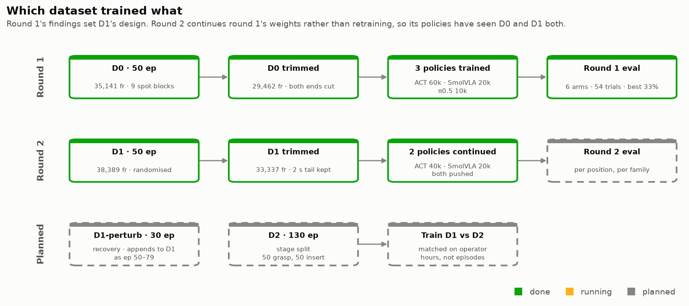
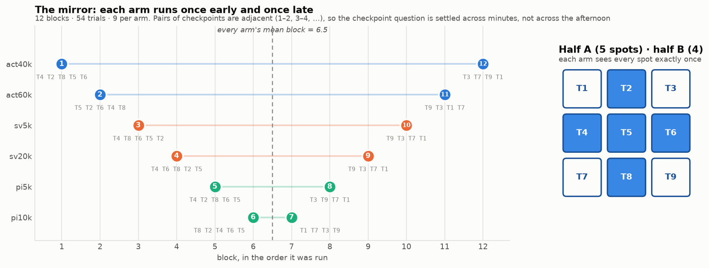
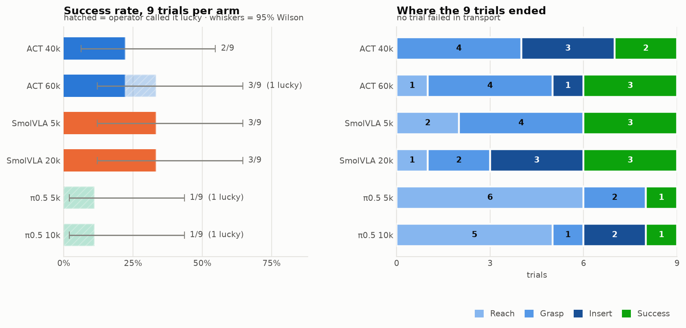
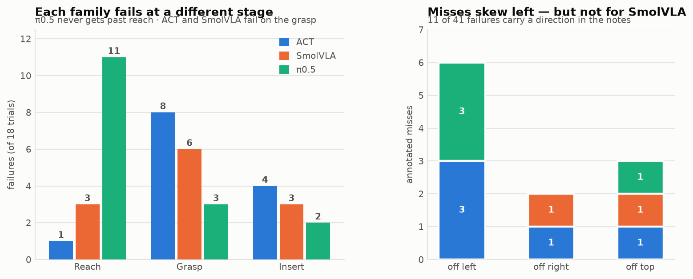
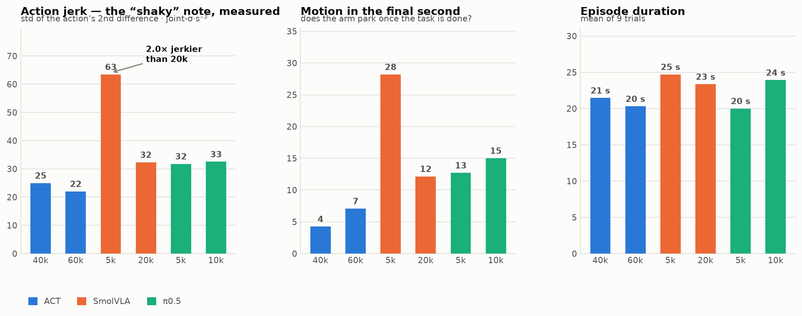
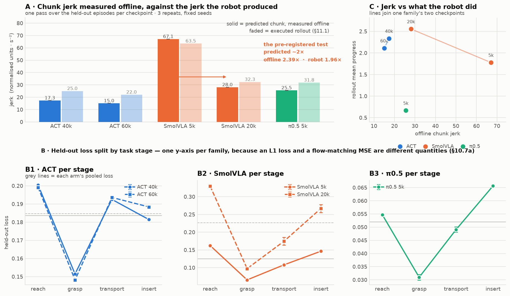
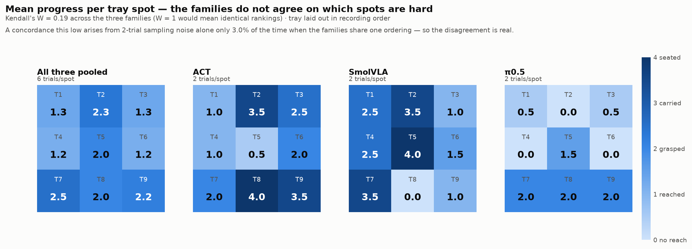
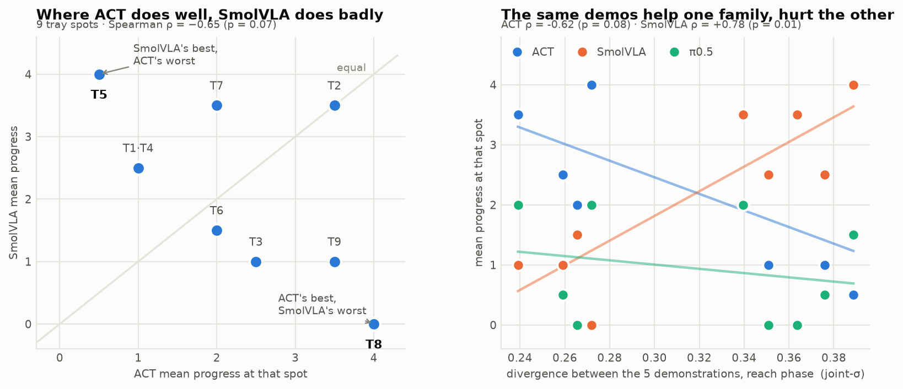
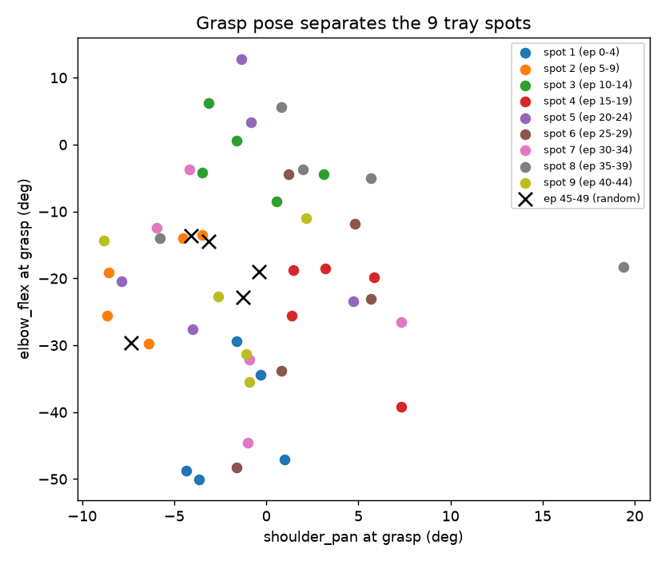
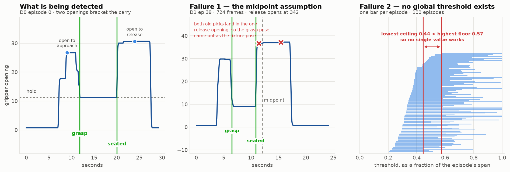

# Phase 0.7 — portable rig: bird's-eye top camera, and a new dataset

Run book for the rebuilt rig and the two collection/eval rounds that follow it. Everything — both
arms, both cameras, the tray and the fixture — is mounted on one acrylic board, and the top camera
has been raised from a third-person view to a **bird's-eye overview of the board**.

Plan: [08 §A.4](../08_data_quality_research.md) · Task: [toolkit_task_card.md](toolkit_task_card.md) ·
Calibration: [calibration/README.md](calibration/README.md) · Predecessors:
[phase05](phase05_camera_test_results.md), [phase06](phase06_camera_ablation_training.md) ·
Training: [phase07_training.md](phase07_training.md) · Verification:
[phase07_data_verification.md](phase07_data_verification.md).
Written 2026-10-03, last revised 2026-10-14.



**Where this stands (2026-10-15).** D0 and round 1 are finished and analysed (§10, §11). D1 is
recorded, verified and trimmed (§12.1–§12.5), and **round-2 training is complete** — ACT at 40,000
steps and SmolVLA at 20,000, both pushed (§12.6). The two offline metrics are measured: **chunk jerk
reproduces the robot's ordering, per-stage loss does not** (§11.3a). **Next: pick SmolVLA's D1
checkpoint by jerk rather than by loss, then run the round-2 rollouts.** π0.5 is gated on §12.7's
probe; D1-perturb (§12.3) and D2 (§12.4) are not started.

---

# Summary

- **Three things changed at once:** the rig is on one portable acrylic board, the top camera is
  bird's-eye instead of third-person, and **both arms were recalibrated 2026-10-03**. All three break
  compatibility with Phase 0.5 / 0.6 — fresh dataset, not an extension (§1).
- **The point of the taller camera is to delete background.** A top-down view at height sees the board
  and little else, so the observation is almost entirely task-relevant and looks the same wherever the
  board is set down. That is the portability claim and the data-quality claim in one (§2).
- **It also fixes a definition.** "Top-left hole" is now a property of the board, not of the camera
  pose (§5).
- **Task string, verbatim in every episode:**
  `Pick up the white cylinder from the green tray and place it in the top left blue hole of the black fixture`
- **Do not mix this data with Phase 0.5 / 0.6.** Different action frame *and* different observation
  space (§4).
- **Round 1's four findings** (§11) drive everything after it: held-out loss ranked the three policy
  families backwards, smoothness explains why, the idle tail should be kept rather than trimmed, and
  spot difficulty belongs to the policy rather than to the position.

| | What | When |
|---|---|---|
| §1–§9 | Rig, calibration, D0 collection and verification | done 2026-10-03 → 10-05 |
| §10 | Round-1 run book — 6 arms, 54 rollouts | run 2026-10-12 |
| §11 | Round-1 results and the four findings | scored 2026-10-12 |
| §12 | Round 2 — D1, processing, continued training | D1 done · training in progress |
| §13 | The deferred success-rate design | for when a policy clears ~50% |

Items marked *Default:* were suggestions fixed before the first episode.

---

# 1 — What changed

| | Phase 0.5 / 0.6 | Phase 0.7 |
|---|---|---|
| Mounting | arms clamped to the table, cameras on separate mounts, positions taped to the table | **everything on one acrylic board** |
| Top camera | third-person, front-side, wide; room visible behind the workspace | **bird's-eye, directly above, much higher**; frames the board and little else |
| Cylinder start | standing on one of 10 taped table positions | **in the green tray** |
| Target | top-left hole, taped, defined in the third-person image | **top-left blue hole** of the black fixture, defined on the board |
| Calibration | 2026-09-16 master (+ `shoulder_pan` fix 09-27) | **recalibrated 2026-10-03**, [`calibration/current/`](calibration/current/) |
| Portability | fixed to one table in one room | **set the board down anywhere and record** |

The three changes are deliberately bundled: the board makes a repeatable high mount possible, the high
mount makes the scene location-independent, and remounting the arms forced the recalibration. So this
phase cannot attribute an outcome to any one of them — accepted, because the purpose is a clean
portable baseline, not an ablation.

# 2 — Why bird's-eye, from the Phase 0.5 / 0.6 results

Two predecessor findings point the same way. **The third-person top view was the aliased one** — it
lost to the wrist camera and even to joint state in every phase but grasp/insert
([phase05](phase05_camera_test_results.md)). And **adding it to the wrist camera made reach *worse***:
`top+wrist` reached 6/10 against `top`'s 10/10, under-shooting the workspace extremes by 17%
([phase06](phase06_camera_ablation_training.md)).

A top-down view attacks both — it raises the share of task-relevant pixels and makes cylinder and hole
position almost affine in image coordinates, which is the geometry reach needs. It removes the arm's
self-occlusion of the table, but introduces the arm occluding the *tray and fixture* from above, which
§6's preflight checks.

**What this phase does not claim.** Whether the bird's-eye view actually lowers divergence is a
confounded comparison here (new frame, new camera, new tray) and should be read as a sanity check. A
clean test would mount the third-person camera on the same board and record both views at once (§9).

# 3 — Rig spec — measure once, write it down

> **Never filled in.** The table below is still blank, and that is a real gap: it is the only thing
> that would let the rig be rebuilt after it is knocked over, and it is a prerequisite for the
> second-location test (§12.8) that the whole portability claim rests on. Fill it before moving the
> board.

| Item | Value |
|---|---|
| Acrylic board | ___ × ___ mm, ___ mm thick |
| Follower base position on board | ___ (mark the outline) |
| Top camera height above board / model / `/dev/v4l/by-id` path | ___ |
| Field of view at board level | covers ___ × ___ mm — must include the whole tray, the whole fixture, and the arm's working area |
| Wrist camera model / path | ___ (previously C922) |
| Green tray / black fixture | ___ × ___ mm; hole pitch ___ mm; outlines marked on the board |
| Cylinder | diameter ___ mm, height ___ mm, hole clearance ___ mm |
| Lighting · USB · Cameractrls presets | ___ (*Default:* LED panel + diffuser; one powered hub, MJPG both cameras; presets reset on replug — reload every session) |

**Photograph the assembled rig** from the side and from the top camera's own view into
[`figs/`](figs/). The top-camera still is the reference image for "is the board set up right" at the
next location — if the board can be set down elsewhere and the image matches, the rig is portable.

# 4 — Calibration

Both arms were recalibrated **2026-10-03**; the deployed pair is
[`calibration/current/`](calibration/current/), previous frames archived beside it. Numbers and
restore procedure: [calibration/README.md](calibration/README.md).

- **The follower's narrowed `shoulder_pan` range is intentional** — 2688 → 2449 counts (−21.0°),
  covering the board's working area. Reviewed and kept.
- **Back up before touching anything**; Phase 0.5 / 0.6 assets need their own frame restored before any
  replay or rollout.
- **Do not re-run `lerobot-calibrate`** for round 2 — a new frame makes D1 unmergeable with D0.

# 5 — Task card delta

Full card: [toolkit_task_card.md](toolkit_task_card.md). Phase 0.7 changes:

| Entry | Phase 0.7 value |
|---|---|
| Start state | cylinder **in the green tray**, standing upright; arm at home, gripper open |
| Cylinder position | **VARIES** within the tray — D0 used a 3×3 marked grid, D1 randomises continuously (§12.2) |
| Target | **top-left blue hole** as seen from the bird's-eye camera — the board's own top-left, not a camera-dependent direction |
| Success | unchanged: within 30 s, fully seated in that hole, gripper released |
| Stages | unchanged: reached 0.2 · grasped+lifted 0.4 · over the hole 0.6 · inserted 0.8 · seated+released 1.0 |
| Fixed | tray and fixture outlines, lighting, both camera poses, Cameractrls presets, one cylinder |

**Grasping out of a tray is not the same problem as grasping off a table** — the walls constrain the
approach and can block a straight-down grasp near an edge. D0 kept one grasp style with spots placed
clear of the walls; D1 deliberately inverts this (§12.2).

# 6 — Preflight, before the first real episode

1. **Cameras.** Load the Cameractrls presets. In rerun: gripper tip sharp in `wrist`; bird's-eye `top`
   not dark, not motion-blurred, showing **the whole tray and fixture with the arm at home**.
2. **Occlusion sweep.** Teleoperate a full episode watching `top` — confirm the **target hole is
   visible at insertion** and the **cylinder is visible in the tray at the start**. If the arm hides
   the hole, move the camera or rotate the board and re-do §3's reference still.
3. **Wrist visibility.** The cylinder enters the wrist view during the approach, as in Phase 0.5.
4. **Reach test.** Hand-drive the follower to every tray spot and to the target hole, all inside the
   narrowed `shoulder_pan` range with margin.
5. **Five throwaway episodes** to a scratch `repo_id`, `push_to_hub=false`. Watch them back, then
   **replay one** — a clean replay clears the new calibration and the mounting. Delete the scratch set.

# 7 — Recording

lerobot 0.6.1. Re-check `ls /dev/v4l/by-id/` — paths change if a camera was swapped.
Keys: **→** ends the episode early · **←** re-records it · **Esc** stops.

```bash
cd /home/bj/Documents/bingjian/robot_learning/smolvla_so101 && source ~/miniforge3/etc/profile.d/conda.sh && conda activate lerobot && TOP=/dev/v4l/by-id/usb-046d_HD_Pro_Webcam_C920_A8C83F4F-video-index0 && WRIST=/dev/v4l/by-id/usb-046d_C922_Pro_Stream_Webcam_5B3ADD8F-video-index0 && lerobot-record --robot.type=so101_follower --robot.port=/dev/ttyACM0 --robot.id=my_follower --teleop.type=so101_leader --teleop.port=/dev/ttyACM1 --teleop.id=my_leader --robot.cameras="{ top: {type: opencv, index_or_path: $TOP, width: 640, height: 480, fps: 30, fourcc: MJPG}, wrist: {type: opencv, index_or_path: $WRIST, width: 640, height: 480, fps: 30, fourcc: MJPG} }" --dataset.repo_id=HALDijkstraaa/so101_tray_cylinder_portable --dataset.single_task="Pick up the white cylinder from the green tray and place it in the top left blue hole of the black fixture" --dataset.num_episodes=50 --dataset.episode_time_s=30 --dataset.reset_time_s=3 --dataset.fps=30 --dataset.push_to_hub=true --dataset.private=true --display_data=true
```

- **Camera names stay `top` / `wrist`** so training configs carry over unchanged, even though `top`
  now means something different. Noted in the dataset card.
- **New `repo_id`**, so no tooling can silently resume into the Phase 0.5 dataset. 0.6.1 appends the
  start time; record the full stamped name in §8. To add episodes later, pass the stamped name with
  `--resume=true`.
- For the throwaway run, change `repo_id`, set `num_episodes=5` and `push_to_hub=false`.

# 8 — The datasets, as recorded

| | Repo | Episodes | Frames | Use |
|---|---|---|---|---|
| **D0 raw** (10-03) | [`..._portable_20261003_211912`](https://huggingface.co/datasets/HALDijkstraaa/so101_tray_cylinder_portable_20261003_211912) | 50 | 35,141 | archive · analysis |
| **D0 trimmed** | [`..._portable_20261003_211912_trimmed`](https://huggingface.co/datasets/HALDijkstraaa/so101_tray_cylinder_portable_20261003_211912_trimmed) | 50 | **29,462** (83.8%) | round-1 training |
| **D1 raw** (10-13) | [`..._varied_20261013_082911`](https://huggingface.co/datasets/HALDijkstraaa/so101_tray_cylinder_varied_20261013_082911) | 50 | 38,389 | archive · §12.1's P4 check |
| **D1 trimmed** | [`..._varied_20261013_082911_trimmed`](https://huggingface.co/datasets/HALDijkstraaa/so101_tray_cylinder_varied_20261013_082911_trimmed) | 50 | **33,337** (87%) | round-2 training |

All private, `v3.0`, 30 fps, `top` + `wrist` at 480×640 AV1. D0's trimmed copy was built 2026-10-05 by
[colab_phase07_prep_trim.ipynb](../../notebooks/colab_phase07_prep_trim.ipynb) (both ends); D1's was
built 2026-10-13 by [`make_trimmed_dataset.py`](../../scripts/make_trimmed_dataset.py) with
`--tail-cap 60`, which keeps the tail (§12.5). **Train on the trimmed copies.**

**Train/eval split for every run: holdout `[9, 19, 29, 39, 49]`**, placed in the tail of
`--dataset.episodes` so lerobot's "last N" split takes exactly those. The default split would hold out
episodes 45–49, which in D0 are the only **off-grid** tray placements.

## What was asked for, and what actually happened

Two collection instructions were written for D0 and **neither took** — which is why both became
mechanisms rather than reminders in D1.

| Asked | D0 outcome | Fixed in |
|---|---|---|
| **Shuffle positions**, visiting every spot once per round | **Not done** — ep 0–44 are 9 tray-spot blocks of 5 (a 3×3 grid), 45–49 random. Position is confounded with session time again, and the default holdout would have taken exactly the 5 off-grid episodes | §12.2 — continuous randomisation, verified at **1×** block separation |
| **Start moving the instant the episode starts** | **Not done** — median lead-in **71 frames (2.38 s)**, essentially Phase 0.5's 74, with 47/50 episodes idle longer than one 50-step chunk | the head trim, which is mandatory rather than optional (§12.5) |

The D0 block structure is recoverable from the data — the grasp pose separates the 9 spots at **27×**
(verification report §5) — which is what makes §11.6's per-position analysis possible at all.

**`phase07_log.csv` was never kept**, so per-episode `success` and `stage` for the *training* data are
not recoverable ([verification §6](phase07_data_verification.md)). One row per episode —
`episode_index, round, tray_spot, success, stage, location, notes` — cannot be reconstructed
afterwards. `location` matters because the board is portable.

# 9 — Done when, and what is still open

- Rig measured and photographed (§3) — **still outstanding**.
- A Phase 0.7 episode replays cleanly on the new calibration ✅
- 50 D0 episodes recorded, pushed and logged ✅ (with the two deviations above)
- Dataset card states: new calibration frame, bird's-eye `top`, not compatible with
  `so101_toolkit_cylinder_20260917_165544` ✅

**Revised 2026-10-05.** The original plan was to re-run the divergence analysis and the camera
ablation on this dataset. **Both are deferred** — they are camera-placement questions, and the dataset
is wanted for the policy-transfer question (Q2) instead. What ran instead is §10–§12.

**Still open, in no particular order:**

1. Re-run the Phase 0.5 divergence analysis on this dataset and put the numbers beside the old ones.
   Confounded, so read it as a sanity check: does the top view stop being the aliased one?
   (Verification §4b already found one piece for free — the bird's-eye view is blind to the wrist tilt
   every episode opens with.)
2. Retrain the three-way camera ablation on it. The sharp question is whether `top+wrist` still
   under-reaches; if the degradation was background-driven it should shrink here.
3. **Record a second location** — the only direct test of portability, and the claim this whole phase
   is built on.
4. If (1) looks worth doing properly, mount the old third-person camera on the board as a third stream
   and record both views at once, turning a confounded comparison into a controlled one.

---

# 10 — Round 1 eval: six arms, 54 rollouts

Written 2026-10-12 after all three training runs finished and every checkpoint below was loaded and
timed on this machine. **Run 2026-10-12; results in §11.**

**Round 1 is a checkpoint-selection pass, not a success-rate measurement.** Each policy finished with
an unsettled checkpoint question, cheap to answer on the robot and impossible to answer from the loss
curves:

| Policy | The open question | Why the loss cannot answer it |
|---|---|---|
| ACT | Is 60k wasted compute over 40k? | Eval loss is flat from 20k; the 20k–60k spread is checkpoint wobble |
| SmolVLA | Does the +61% eval-loss rise from 5k to 20k show up as worse *behavior*? | [phase06 §2](phase06_camera_ablation_training.md) found held-out loss separated conditions by less than one curve's wobble while the robot showed a decisive dissociation |
| π0.5 | Which checkpoint at all? | Its `eval_loss` values live only in wandb run `sxpkx9st` — read later, §10.7a |

So round 1 runs **two checkpoints per policy** and lets the robot rank them. At 9 trials per arm the
success counts carry a ±16 point standard error, so **the rate is round 2's job** (§13).

## The six arms

| Arm | Policy | Checkpoint | Samples | Epochs | Held-out loss | Hub repo |
|---|---|---|---|---|---|---|
| `act40k` | ACT | `040000` | 320,000 | **12.0** | in the flat 0.179–0.192 band | [`act_tray_cylinder_s1000_trim`](https://huggingface.co/HALDijkstraaa/act_tray_cylinder_s1000_trim) |
| `act60k` | ACT | `060000` | 480,000 | 18.0 | 0.1792 @50k (min) → 0.1848 @55k | same |
| `sv5k` | SmolVLA | `005000` | 320,000 | **12.0** | **0.1258 — the minimum** | [`smolvla_tray_cylinder_s1000_trim`](https://huggingface.co/HALDijkstraaa/smolvla_tray_cylinder_s1000_trim) |
| `sv20k` | SmolVLA | `020000` | 1,280,000 | 47.9 | rises monotonically; 0.2029 @15k (+61%) | same |
| `pi5k` | π0.5 | `005000` | 80,000 | 3.0 | ≈0.0532 @2,500, still falling (§10.7a) | [`pi05_tray_cylinder_s1000_trim_A100`](https://huggingface.co/HALDijkstraaa/pi05_tray_cylinder_s1000_trim_A100) |
| `pi10k` | π0.5 | `010000` | 160,000 | 6.0 | ≈0.0515 @7,500 | same |

**`act40k` and `sv5k` are both exactly 320,000 samples** — 40,000 × 8 and 5,000 × 64 land on the same
number, giving an **exactly sample-matched ACT-vs-SmolVLA pair** at 12.0 epochs on identical data,
holdout and seed. That is a far cleaner Q2 comparison than matched *recipes*, and it costs nothing. It
does not extend to π0.5, whose largest checkpoint is 160,000 samples — it stays the sample-starved
arm, and any π0.5 result has to be read with that attached.

**π0.5's pair was chosen by bracketing**: 3.0 and 6.0 epochs, the same 2× step as the other two pairs.
002500 was left out as implausibly early, 007500 as too close to 010000 to separate.

## 10.1 — Setup, already done and measured

**The six checkpoints are downloaded** to `outputs/hub/` — 20 GB, `pretrained_model` directories only
(optimizer state is 2.2 GB per π0.5 checkpoint and is not needed for inference):

```bash
cd /home/bj/Documents/bingjian/robot_learning/smolvla_so101 && source ~/miniforge3/etc/profile.d/conda.sh && conda activate lerobot && for spec in "act_tray_cylinder_s1000_trim:040000" "act_tray_cylinder_s1000_trim:060000" "smolvla_tray_cylinder_s1000_trim:005000" "smolvla_tray_cylinder_s1000_trim:020000" "pi05_tray_cylinder_s1000_trim_A100:005000" "pi05_tray_cylinder_s1000_trim_A100:010000"; do R=${spec%%:*}; C=${spec##*:}; hf download HALDijkstraaa/$R --include "checkpoints/$C/pretrained_model/*" --local-dir outputs/hub/$R; done
```

**All six load and run inside the control-loop budget on the 5080.** This was the open hardware risk —
the policies were trained on A100/L4 class cards and π0.5 is 4.14 B parameters, so whether it ran at
all on a 16 GB laptop was unknown. Measured with
[`bench_rollout_latency.py`](../../scripts/bench_rollout_latency.py), which feeds synthetic
observations through the real preprocessor and policy; full output in
[`results/phase07_eval/`](../../results/phase07_eval/bench_rollout_latency_5080.txt).

| Arm | Params | Peak VRAM | Chunk latency (median / worst) | Headroom at `n_action_steps=25` |
|---|---|---|---|---|
| `act40k` / `act60k` | 51.6 M | **0.27 GiB** | 8–9 ms / 9 ms | **89–94×** |
| `sv5k` / `sv20k` | 450.0 M | **0.91 GiB** | 100–105 ms / 101–106 ms | **7.9–8.3×** |
| `pi5k` / `pi10k` | 4,143.4 M | **8.87 GiB** of 15.5 | 282–288 ms / 316 ms | **2.6×** |

Three things follow, and they are what make §10.4's commands as simple as they are:

1. **π0.5 fits, with 6.6 GiB spare.** Its 9.35 GB checkpoint is 533.6 M F32 plus 3.61 B BF16
   parameters; under the config's `dtype: bfloat16` that is 8.71 GiB of weights before activations.
2. **Plain sync inference is enough. `--inference.type=rtc` is not needed** — RTC exists for policies
   that cannot compute a chunk inside its execution window, and the slowest arm uses 316 ms of 833 ms.
3. **`n_action_steps=25` is affordable for every arm** (§10.2).

**The Phase 0.6 ACT patch was reverted 2026-10-12.** It had been left applied to the local lerobot
checkout since F2, and the first bench run emitted
`WARNING: Missing key(s) when loading model: {'model.camera_id_embed.weight'}` on both ACT arms.

```bash
git -C /home/bj/code/lerobot checkout src/lerobot/policies/act/modeling_act.py
```

**It did not affect the rollout, and that is measured rather than argued.** The patch adds a
`camera_id_embed` that is `nn.init.zeros_`-initialised; a Phase 0.7 checkpoint carries no such key, so
it stays zero and `cam_features + 0` is stock ACT. Predicting an action from the same fixed input under
both versions gives **bit-identical output, max abs diff 0.0** — so the bench numbers taken under the
patch stand. Reverted anyway for two reasons: the embedding was tested in F2 and **found no benefit**,
and its warning is textually indistinguishable from a *real* state-dict mismatch, which lerobot logs
rather than raises. A clean ACT load now prints nothing, so any warning from here is worth stopping
for. If Phase 0.6 F3 blocks 2–3 are ever picked up, `act_both_s1000_camemb` needs
`scripts/patch_act_camera_embed.py` re-applied.

**SmolVLA fetches its VLM backbone at load time** — `HuggingFaceTB/SmolVLM2-500M-Video-Instruct` is
pulled from the Hub on every `from_pretrained`, not bundled. It is cached now, but a cleared cache
means the `sv5k`/`sv20k` blocks need network.

## 10.1a — GPU power during rollouts: a low reading is expected

Measured 2026-10-12 under a 140 s sustained π0.5 inference loop, sampled every 0.25 s.

| | Idle, between chunks | **Computing** |
|---|---|---|
| Utilisation | 0–2% | **96–100%** |
| Power | 11–17 W | **78.7 W median, 82.1 W peak** |
| SM clock | 180 MHz | **1,740 MHz median** |
| P-state / temp | P8, 40 °C | **P0, 51–55 °C** |

A `nvidia-smi` sample during a rollout showing *38 W of 80 W at 2% utilisation* is an **idle sample
between chunks**, not throttling: a 277 ms chunk inside an 833 ms budget is a **33% duty cycle**, so
the average has to look low.

**Do not raise the power limit for an eval session.** It buys nothing — π0.5 uses 277 ms of 833 ms, and
halving that changes no policy output and no rollout timing, because the policy is called on a fixed
25-step cadence either way. Worse, **changing it between blocks would be a real confound** that
§10.3's mirror does not protect against: the mirror controls for drift continuous in session time,
while a power-limit change at block 7 is a step intervention landing on specific arms. If you want a
higher limit, set it once before block 1, never touch it again, and record that you did.

**Where the cap does cost you is training** — §12.6a has that measurement, and it is the opposite case.

## 10.2 — Every arm re-observes at the same rate: `n_action_steps=25`

All six arms run `--policy.n_action_steps=25`, overriding what each checkpoint stores (ACT 100, both
VLAs 50). This is deployment-only — the policy still predicts its full `chunk_size`; the flag says how
much to execute before re-predicting — so it changes no weights.

**Why matched, and why 25.** [phase06 §2](phase06_camera_ablation_training.md) rejected a rollout
setting *specifically* because it would have given conditions different effective control rates, then
had to accept that problem in reverse when the stored 100 throttled the effect under test to ~9
observations per episode. Round 1 compares families whose stored values differ by 2×, so leaving them
alone would confound the cross-family comparison with the re-observation rate. 25 is the matched value
that is also the tightest every arm can afford: 0.83 s of open-loop motion, ~36 observations per 30 s
episode, against a measured worst case of 316 ms.

It is also the value Phase 0.6 F3 confirmed **on trimmed data** — 25 stalled the arm at the home pose
on untrimmed Phase 0.5 data (the idle-attractor failure) and worked immediately once the data was
trimmed. Phase 0.7 trains exclusively on trimmed copies, so that condition is satisfied by
construction.

> If an arm stalls at the home pose anyway, that is a **result, not a setup failure**. Record it as a
> stall and keep the flag identical across all six.

## 10.3 — Positions, schedule, and what the mirror buys

**Nine marked grid tray spots, `T1`–`T9`** — the 3×3 grid of §8, each with 5 training episodes behind
it, so round 1 is entirely in-distribution. The five off-grid placements of episodes 45–49 are **not**
evaluated here; they test the memorisation hypothesis and are deferred to round 2 so there is an
in-distribution baseline to read them against.

> **`T`*k* is the *k*-th spot visited during collection**, so its five demonstrations are episodes
> 5(*k*−1)…5(*k*−1)+4, and `T1` is the spot episodes 0–4 used. Confirmed 2026-10-12 against the
> operator's dataset screenshots and against the grid geometry: laid out 3×3 row-major the grasp
> bearing is a regular raster, +4.1…+5.8° along each row and −3.5…−5.6° down each column. This mapping
> is what lets rollout outcomes be joined to the demonstrations recorded at the same spot (§11.6).
> **Keep using it; do not relabel.**

`lerobot-rollout` records N episodes of one checkpoint in a row, so a fully interleaved trial order
would mean 54 process restarts and 54 model reloads — at 9.35 GB a time for π0.5. Instead the nine
spots split into two halves and every arm runs once per half, in **mirrored order**:



The script asserts the third property rather than trusting it:

- **Each arm sees each of the nine spots exactly once**, so tray spot is a within-arm constant and
  cannot confound any arm against any other. This is why 9 trials per arm rather than 10 — a tenth
  would have to repeat a spot.
- **Each policy's two checkpoints are adjacent**, so the primary question is settled across minutes of
  session time rather than across the whole afternoon.
- **Every arm has the same mean session position, 6.5 of 12.** Drift linear in session time — lighting,
  servo warm-up, operator fatigue — cancels out of *every* comparison instead of landing on whoever ran
  last. This is the 6-arm generalisation of the ABBA interleave phase06 F2 used for 2.

The schedule is pre-generated into [phase07_eval_log.csv](phase07_eval_log.csv), 54 rows with outcome
columns blank:

```bash
cd /home/bj/Documents/bingjian/robot_learning/smolvla_so101 && python3 scripts/make_phase07_eval_schedule.py --seed 0 > docs/details/phase07_eval_log.csv
```

**Budget ~2–2.5 h**: 54 episodes at up to 60 s plus 10 s resets is ~45–60 min; 12 model loads add
~10 min (π0.5 dominates); the rest is setup and between-block cylinder moves.

## 10.4 — The twelve commands

Rig setup is **follower only** on `/dev/ttyACM0` (with no teleop connected the episodic strategy
returns the arm to the joint positions captured at startup between episodes), arm **in the home pose
before you start**, Cameractrls presets loaded, board and fixture on their outlines. Run §10.5's
preflight first, and re-check `ls /dev/v4l/by-id/`.

> **The assignments must be separated by `&&`, not spaces.** Written as a command *prefix*
> (`ARM=act40k lerobot-rollout … $ARM …`) the shell expands `$ARM` on that line *before* applying the
> assignment, so the policy path becomes a garbage string and `from_pretrained` falls through to the
> Hub with `HFValidationError`. phase06 §4a lost a session to this.

**ACT** (blocks 1, 2, 11, 12) — no `--rename_map`; ACT trained on `observation.images.top` / `.wrist`
directly, which is what the robot produces:

```bash
cd /home/bj/Documents/bingjian/robot_learning/smolvla_so101 && source ~/miniforge3/etc/profile.d/conda.sh && conda activate lerobot && POLICY=outputs/hub/act_tray_cylinder_s1000_trim/checkpoints/040000/pretrained_model && NAME=rollout_phase07_r1_act40k_a && NEP=5 && TOP=/dev/v4l/by-id/usb-046d_HD_Pro_Webcam_C920_A8C83F4F-video-index0 && WRIST=/dev/v4l/by-id/usb-046d_C922_Pro_Stream_Webcam_5B3ADD8F-video-index0 && lerobot-rollout --strategy.type=episodic --policy.path=$POLICY --policy.n_action_steps=25 --robot.type=so101_follower --robot.port=/dev/ttyACM0 --robot.id=my_follower --robot.cameras="{ top: {type: opencv, index_or_path: $TOP, width: 640, height: 480, fps: 30, fourcc: MJPG}, wrist: {type: opencv, index_or_path: $WRIST, width: 640, height: 480, fps: 30, fourcc: MJPG} }" --dataset.repo_id=HALDijkstraaa/$NAME --dataset.no_stamp=true --dataset.single_task="Pick up the white cylinder from the green tray and place it in the top left blue hole of the black fixture" --dataset.num_episodes=$NEP --dataset.episode_time_s=60 --dataset.reset_time_s=10 --dataset.fps=30 --dataset.push_to_hub=false --display_data=true
```

**SmolVLA** (3, 4, 9, 10) adds `--rename_map`. **Mandatory, not cosmetic:** the checkpoint's feature
names come from `smolvla_base` and win over the dataset's, so it expects `camera1`/`camera2` and the
run dies on a feature mismatch without the map. Insert into the command above, after
`--policy.n_action_steps=25`:

```bash
RENAME='{"observation.images.top": "observation.images.camera1", "observation.images.wrist": "observation.images.camera2"}'   # then add  --rename_map="$RENAME"
```

**π0.5** (5, 6, 7, 8) — same shape, different map:

```bash
RENAME='{"observation.images.top": "observation.images.base_0_rgb", "observation.images.wrist": "observation.images.left_wrist_0_rgb"}'
```

Change only `POLICY`, `NAME`, `NEP` and (for the VLAs) `RENAME`. Half A is `NEP=5`, half B `NEP=4`;
cylinder order inside each block is the schedule's.

| Block | Arm | `POLICY` checkpoint under `outputs/hub/` | `NAME` suffix | `NEP` |
|---|---|---|---|---|
| 1 / 12 | `act40k` | `act_tray_cylinder_s1000_trim/checkpoints/040000` | `act40k_a` / `act40k_b` | 5 / 4 |
| 2 / 11 | `act60k` | `act_tray_cylinder_s1000_trim/checkpoints/060000` | `act60k_a` / `act60k_b` | 5 / 4 |
| 3 / 10 | `sv5k` | `smolvla_tray_cylinder_s1000_trim/checkpoints/005000` | `sv5k_a` / `sv5k_b` | 5 / 4 |
| 4 / 9 | `sv20k` | `smolvla_tray_cylinder_s1000_trim/checkpoints/020000` | `sv20k_a` / `sv20k_b` | 5 / 4 |
| 5 / 8 | `pi5k` | `pi05_tray_cylinder_s1000_trim_A100/checkpoints/005000` | `pi5k_a` / `pi5k_b` | 5 / 4 |
| 6 / 7 | `pi10k` | `pi05_tray_cylinder_s1000_trim_A100/checkpoints/010000` | `pi10k_a` / `pi10k_b` | 5 / 4 |

Full name is `rollout_phase07_r1_<suffix>`. Four flags are worth knowing why:

- **The name must start with `rollout_`** — `build_rollout_context` rejects anything else
  (`rollout/context.py:431`), and it is a **runtime** check, so it fires only after the robot and
  cameras have connected.
- **The third declared camera is fine, and it differs between the VLAs.** Both checkpoints declare a
  camera the two-camera rig cannot feed — SmolVLA a `camera3`, π0.5 a `right_wrist_0_rgb`. **SmolVLA
  drops it** (`modeling_smolvla.py:374-375`), **π0.5 pads it with −1 and masks it out**
  (`modeling_pi05.py:1011-1012`). Both match what training did, since training also fed only two.
  Nothing to configure — but it is why the model card's auto-generated `lerobot-rollout` command does
  not work as printed: it carries no rename map.
- **`episode_time_s=60`** against a 30 s success window — the window still defines success, but a hard
  cutoff leaves no slack on a loaded CPU. Press **→** when the outcome is clear.
- **`--dataset.push_to_hub=false`** — 54 episodes of two 480×640 streams stay in
  `~/.cache/huggingface/lerobot/HALDijkstraaa/`.

## 10.5 — During the session, and scoring

- **→** ends the episode or reset early · **←** discards and re-records · **Esc** stops the block.
- Use **←** only for a *rig* problem — cylinder knocked over, wrong spot placed. **Do not re-record
  because the policy failed.** The failures are the data.
- **If an arm does not move by ~10 s, record it as a stall and press →.** Do not wave at the camera.

**Preflight — two hard stops.** The rig was reported untouched since the 2026-10-03 recording, so this
verifies rather than rebuilds.

**1. Replay episode 0 of the D0 raw dataset.** This is the only acceptance test that separates "the
calibration frame is right" from "it looks right": `lerobot-replay` plays a recorded episode's
**actions** straight to the servos — no policy, no camera, no feedback — so if it no longer reaches
what it reached on 2026-10-03, the problem is physical and no policy is in question. It is how the
Phase 0.6 `shoulder_pan` drift was caught.

```bash
cd /home/bj/Documents/bingjian/robot_learning/smolvla_so101 && source ~/miniforge3/etc/profile.d/conda.sh && conda activate lerobot && lerobot-replay --robot.type=so101_follower --robot.port=/dev/ttyACM0 --robot.id=my_follower --dataset.repo_id=HALDijkstraaa/so101_tray_cylinder_portable_20261003_211912 --dataset.episode=0
```

Arm at home, cylinder at **the spot episodes 0–4 used**, fixture on its outline. Watch **the grasp**
and **the insertion** against the recorded video. **The raw dataset, not the trimmed one** — episode 0
is 878 frames raw against 743 trimmed, and the difference is exactly the idle lead-in and tail, so the
raw episode starts at the home pose where the arm actually is.

**2. Compare the top camera against §3's reference still** with the arm at home.

If either fails, fix it *before* any rollout: a rig shift and a policy failure are indistinguishable
afterwards, and 54 trials is too many to throw away.

**Scoring — from video, blind to arm.** Scoring live favours whichever arm you expect to win, and the
arm name is in the dataset directory name, so scoring blind means shuffling episodes rather than
browsing per-arm folders. Fill in [phase07_eval_log.csv](phase07_eval_log.csv):

| Column | Values |
|---|---|
| `success` | 1 if, **within 30 s**, the cylinder is fully seated in the top-left blue hole and the gripper released (§5) |
| `fail_stage` | `reach` · `grasp` · `transport` · `insert` · `retreat` · `none`, plus **`stall`** |
| `duration_s` | time to the outcome |
| `notes` | and for every grasp attempt, **`shoulder_pan`** — the bird's-eye rig is supposed to have fixed exactly the reach drift phase06 §6.5.3 tracks by its slope |

**`fail_stage` is the column that carries the result**, not `success`. At 9 trials a success count has
a ±16 point standard error, but the *stage* an arm fails at is a per-trial observation, and a shift
from `reach` to `insert` failures is visible in 9 trials when a rate difference is not. It is also the
direct test of §2's prediction that the bird's-eye view fixes reach.

## 10.7 — Pre-registration, committed 2026-10-12 before any rollout

[08 §A.2](../08_data_quality_research.md) asks for predicted orderings committed *before* the
comparison is read. Predictions 1–3 and 5 are the operator's call; 4 and 6 are deliberately open.
**Scored in [§11.2](#112--prediction-scorecard-against-107): 1 and 3 confirmed, 2 and 5 wrong — and
both wrong ones were the loss-based ones.**

| # | Prediction | Confidence | Reasoning |
|---|---|---|---|
| 1 | `act40k` ≈ `act60k`, within 2/9 | **high** | Eval loss is flat from 20k and the spread is checkpoint wobble. If it holds, the dial grid drops ACT to ~30k steps and halves its compute across 19 conditions × 3 seeds |
| 2 | `sv5k` > `sv20k` | **medium** | Held-out loss rises monotonically +61%, far stronger than the sub-wobble differences phase06 dismissed. But loss↛success is what phase06 established, so `sv20k` acting better than its loss is live |
| 3 | `pi10k` > `pi5k` | **high** *(raised)* | **The curve was read** (§10.7a): π0.5's eval loss is still falling at the last checkpoint, with no minimum in range. Underfit, not overfit — so the later checkpoint should win, and the SmolVLA-style reversal is ruled out |
| 4 | At matched 320k samples, `act40k` vs `sv5k` | **open** | 45 episodes is tiny for a 100 M-parameter VLA and ACT's from-scratch chunked bias suits a single-task, low-variance dataset; against that, SmolVLA carries pretrained visual and language priors ACT has none of |
| 5 | **π0.5 is the strongest family** | **medium** | On held-out loss: ≈0.052 against SmolVLA's best 0.126 and ACT's 0.179, and the only one still improving. §10.7a sets out how far that carries — sound against SmolVLA, not available against ACT |
| 6 | Dominant `fail_stage` | **open** | §2 claims the bird's-eye view fixes reach. Whether `insert` overtakes `reach` is what the column is there to find out |

> **Prediction 5 reverses the original draft, which had π0.5 weakest on a sample-count argument** —
> 160k samples against ACT's 480k and SmolVLA's 320k. That argument is not wrong, but it was made
> before the loss curve was read. Both readings are on the record; the rollouts settle it.

**What would change the plan.** If every arm scores ≤1/9, the problem is the rig or the task, not the
checkpoints — stop and diagnose. If all six are indistinguishable at 7–9/9, the task is too easy to
separate policies and round 2 needs the off-grid spots to create headroom.

## 10.7a — π0.5's held-out curve, and how far loss compares across families

**Read from wandb run [`sxpkx9st`](https://forge.coreweave.com/wandb/bj-huang-university-of-toronto/phase07-policy-transfer/runs/sxpkx9st) on 2026-10-12.** The curve **falls monotonically across
the whole logged range** — ≈0.0532 at 2,500 down to ≈0.0515 by 7,500 — with **no minimum reached**.
Two things follow, pointing opposite ways:

1. **π0.5 does not overfit on this dataset**, where SmolVLA did badly at the same 45 episodes. At 6.0
   epochs it is still underfit, so `pi10k` should beat `pi5k` and **more steps would probably help** —
   the 10,000 the A100 inherited from the L4 notebook was short rather than merely different. That is
   a Q2 result in itself: two flow-matching VLAs on identical data with opposite overfitting behaviour
   at 48 vs 6 epochs.
2. **The flat curve means the checkpoint question was never the risk for π0.5** that it was for
   SmolVLA. Running both arms is still right — 18 of 54 trials, and the only on-robot evidence either
   way — but it is a confirmation rather than a coin flip.

**How far 0.052 vs 0.126 vs 0.179 actually carries.** [training §1](phase07_training.md) warns that
held-out loss does not compare across the three. That warning is **right about ACT and too strong
about the other two**, which matters because prediction 5 rests on it:

| | ACT | SmolVLA | π0.5 |
|---|---|---|---|
| Objective | **L1 + KLD on actions** | flow-matching MSE on the velocity field | same |
| Reduced over | 6 action dims | 6, truncated before the mean (`modeling_smolvla.py:303`) | 6 (`modeling_pi05.py:1081`) |
| Flow timestep sampling | — | `Beta(1.5, 1.0)`, scale 0.999, offset 0.001 | **identical** |
| Action normalisation | `MEAN_STD` | `MEAN_STD` | **`QUANTILES`** |

- **ACT against either VLA: no comparison exists.** An L1 on predicted actions and an MSE on a
  flow-matching velocity residual are different quantities with no conversion between them.
- **SmolVLA against π0.5: comparable, up to one measurable factor.** Same objective, reduction,
  timestep distribution and noise. The only difference is the normaliser, and its size is computable
  rather than guessed: `QUANTILES` divides by `(q99−q01)/2`, which across the six joints is **1.36×
  the `std`** `MEAN_STD` uses, so π0.5's targets are ≈0.74× SmolVLA's — through the flow target
  `ε − a` a **≈1.3× deflation**. Correcting puts π0.5 at an effective **≈0.067** against SmolVLA's
  0.126 — still roughly half, so the gap survives and prediction 5 is well-founded *against SmolVLA*.
- **None of it establishes task success.** phase06 §2 is the standing counterexample. A 2× loss gap is
  far larger than that — but it is still the wrong units, and it says nothing about ACT, which is half
  of prediction 5.

**What would settle it properly, and is cheap:** evaluate all three on one policy-agnostic metric —
L1 between the predicted action chunk and ground truth on the held-out episodes, **un-normalised, in
degrees**. Same quantity for every family, directly interpretable, and every piece exists in
[`eval_checkpoints_heldout.py`](../../scripts/eval_checkpoints_heldout.py): swap `policy.forward`'s
loss for `predict_action_chunk` plus an inverse-normalisation step. Worth doing **after** the rollouts,
so the loss-vs-success comparison is not read before the robot has spoken.

---

# 11 — Round 1 results — run and scored 2026-10-12

54 trials, 12 blocks, as §10 specifies. Scored blind from video into
[phase07_eval_log.csv](phase07_eval_log.csv); `episode_index` and `duration_s` recovered from the
recordings by [`analyze_phase07_eval.py`](../../scripts/analyze_phase07_eval.py), which produces every
number and figure below. Summary tables: [`results/phase07_eval/`](../../results/phase07_eval/).

## The four findings to carry forward

1. **Held-out loss does not predict real-robot performance — it ranked the three families exactly
   backwards.** The cause is compounding error: loss is a *per-frame, teacher-forced* quantity scored
   from states the demonstrator reached, while a rollout is scored from states the policy reached.
   §11.3.
2. **A smoothness metric computed from the predicted chunk closes most of that gap** — measured
   2026-10-14 and it holds: chunk jerk reproduces the rollout jerk ordering exactly across five arms,
   with no robot. Splitting the loss by task stage, the other candidate, does not. §11.3a.
3. **Keep the tail idle frames.** Trim the head — the F3 idle attractor is real — but the tail is the
   only place a policy can learn "the task is done, hold still", and its absence is measurable:
   SmolVLA moves 3.6× as much as ACT in the final second. §11.5.
4. **Tray-spot difficulty is a property of the *policy*, not of the position.** The three families
   disagree about which spots are hard (Kendall's W = 0.19; that low only 3% of the time under
   sampling noise alone), and ACT's best spot is SmolVLA's worst. §11.6.

> **Finding 4 is the one with reach beyond this phase.** [08 §A.1](../08_data_quality_research.md)
> records that the 2025 causal-quality line — CUPID and successors — paid for rigour by making quality
> "**tied to one policy** … the score only holds for that policy," and that 2026's reaction was to
> retreat to model-free proxies (RINSE, PSD scores) on the argument that policy-in-the-loop curation
> does not scale. **Round 1 is a direct empirical instance of the thing the model-free line assumes
> away**: the same 50 demonstrations, everything fixed but the policy, produce opposite per-position
> outcomes. A model-free score cannot express that, because the quantity it estimates does not exist
> independently of the learner. It does not make model-free proxies useless — it bounds what they can
> claim, and it says a Q2 answer must be reported per policy family rather than pooled.

**Headline: nothing works well yet, and the held-out loss ranking was exactly inverted.** The policy
with the *lowest* held-out loss (π0.5) is the only one that never completed the task on its own; the
policy whose loss said it was 61% overfit (SmolVLA 20k) is the most capable thing in the set.

| | ACT | SmolVLA | π0.5 |
|---|---|---|---|
| Success | 5/18 · **27.8%** | **6/18 · 33.3%** | 2/18 · 11.1% |
| Success, excluding "lucky" | 4/18 · 22.2% | **6/18 · 33.3%** | **0/18 · 0.0%** |
| 95% Wilson | 12.5–50.9% | 16.3–56.3% | 3.1–32.8% |
| Mean progress (of 4 stages) | 2.22 | 2.17 | **0.94** |
| Dominant failure | **grasp** (8) | grasp (6) | **reach (11)** |
| Held-out loss rank | 3rd | 2nd | **1st** |



## 11.1 — Per arm

| Arm | Success | Clean | Progress | Duration | Jerk | Terminal motion | reach / grasp / insert |
|---|---|---|---|---|---|---|---|
| ACT 40k | 2/9 | 2 | 2.33 | 21.5 s | 25 | **4.3** | 0 / 4 / 3 |
| ACT 60k | 3/9 | 2 | 2.11 | 20.3 s | **22** | 7.1 | 1 / 4 / 1 |
| SmolVLA 5k | 3/9 | 3 | 1.78 | 24.7 s | **63** | **28.2** | 2 / 4 / 0 |
| SmolVLA 20k | 3/9 | 3 | **2.56** | 23.4 s | 32 | 12.1 | 1 / 2 / 3 |
| π0.5 5k | 1/9 | **0** | 0.67 | 20.0 s | 32 | 12.7 | 6 / 2 / 0 |
| π0.5 10k | 1/9 | **0** | 1.22 | 23.9 s | 33 | 15.0 | 5 / 1 / 2 |

**Three trials carry a "lucky" note** and they matter disproportionately: π0.5 5k's only success was a
cylinder *kicked* into the hole, π0.5 10k's was another "lucky move", and ACT 60k's a "lucky grasp".
Excluding them, **π0.5 scores 0/18** — it never performed the task deliberately. They are kept in the
primary count because they meet the task card's definition, and split out everywhere because they are
not evidence of capability.

**Durations are uninformative** (20.0–24.7 s across all six arms, against a 30 s window and a 60 s
recording cap). The operator pressed → once the outcome was clear, so duration mostly measures how
long it took *to become obvious*.



**No trial failed in transport, across all 54.** Every policy that got the cylinder off the tray got it
over the fixture — which is the basis of §12.4's 50/10 collection split.

## 11.1a — How much of the family difference is just epoch count?

**The three families did not see the same amount of data** — [training §1](phase07_training.md) held
the dataset, holdout, seed and cameras fixed but let each policy keep its own published recipe:

| | batch × steps | samples | **epochs of D0** |
|---|---|---|---|
| ACT | 8 × 60,000 | 480,000 | **18.0** |
| SmolVLA | 64 × 20,000 | 1,280,000 | **47.9** |
| π0.5 | 16 × 10,000 | 160,000 | **6.0** |

SmolVLA saw **2.7×** ACT's epochs and **8.0×** π0.5's, so the *pooled* per-family rates in §11.1 carry
an epoch confound and should not be read as "SmolVLA beats ACT" full stop.

**Where it matters most: π0.5.** Its 0/18 is the headline of §11.4, and it is the arm with one third of
ACT's data exposure and one eighth of SmolVLA's. That is why §11.4's claim is "at this data and compute
budget, π0.5 is not competitive" rather than "π0.5 is bad at this task".

**Where it does not matter: the sample-matched pair.** **ACT 40k and SmolVLA 5k are both exactly
320,000 samples / 12.0 epochs**, and that pair went **2/9 vs 3/9** with mean progress **2.33 vs 1.78** —
no separation either way, well inside noise at n = 9. The clean comparison round 1 contains says the
two families are indistinguishable at matched data; the 4-point pooled gap is the epoch asymmetry
showing through.

**Where it is largely immune: §11.6's interaction.** The policy × position finding is about *which*
spots each family does well at, not its overall level. An epoch difference shifts a family's level
across all nine spots; it does not reorder them. So the double dissociation at T5/T8 survives the
confound, which is part of why it is the most robust result in round 1.

§12.6 keeps the sample-matched pair deliberately rather than by luck.

## 11.2 — Prediction scorecard against §10.7

| # | Predicted | Outcome | |
|---|---|---|---|
| 1 | `act40k` ≈ `act60k`, within 2/9 | 2/9 vs 3/9 — within 1, and progress 2.33 vs 2.11 runs the *other* way | ✅ **confirmed** |
| 2 | `sv5k` > `sv20k` | 3/9 vs 3/9 on success, but 20k leads on progress (2.56 vs 1.78) and is half as jerky | ❌ **wrong — reversed** |
| 3 | `pi10k` > `pi5k` | 1/9 each, but progress 1.22 vs 0.67 and 10k is the only one to reach an insert | ✅ **weakly confirmed** |
| 4 | open — matched 320k samples | 2/9 vs 3/9, progress 2.33 vs 1.78. Inside noise either way | — **unresolved**, as expected |
| 5 | π0.5 strongest | π0.5 is **last** on every measure, and 0/18 excluding luck | ❌ **wrong, decisively** |
| 6 | open — dominant fail stage | No single stage dominates: π0.5 fails at reach (11/18), ACT and SmolVLA at grasp | — **answered: policy-specific** |

**Two of four committed predictions were wrong, and both wrong ones came from held-out loss.** 1 and 3
were loss-based too but happen to be where loss and behaviour agreed. 2 and 5 are where the loss
comparison was load-bearing — and §10.7a's caveat that loss is "the wrong units for the question"
turned out to be the whole story.

## 11.3 — The SmolVLA inversion, and why a per-frame loss cannot see it

The most interesting result in round 1. **SmolVLA 5k has the best held-out loss in its family by 61%
and behaves worse on the robot than 20k.** The session note called 5k "shaky" and 20k "very smooth",
and that is measurable in the recorded actions rather than a matter of impression:



| | SmolVLA 5k | SmolVLA 20k |
|---|---|---|
| Held-out loss | **0.1258** (best in family) | ~0.2029 (+61%, measured at 15k) |
| Success | 3/9 | 3/9 |
| Mean progress | 1.78 | **2.56** |
| **Action jerk** | **63.5** | **32.3** — half |
| Failures | 2 reach, 4 grasp, **0 insert** | 1 reach, 2 grasp, **3 insert** |

5k is **2.0× jerkier**, and the failure profile shifts: 5k mostly never gets the cylinder, 20k usually
does and then misses the hole. Getting far enough to fail at insertion is strictly more progress than
failing at the grasp.

**Why the loss misses it.** Held-out loss is a *per-frame, teacher-forced* quantity: each prediction is
scored against ground truth from a state the *demonstrator* reached. A rollout is the opposite — the
policy is scored from states *it* reached, so a small per-frame error feeds the next observation and
compounds. That is the classic covariate-shift gap, with a specific shape here:

- A **jittery** policy can have excellent per-frame loss. Jitter is high-frequency and roughly
  zero-mean, so it barely moves an L1/MSE average, while on hardware it shakes the gripper off a
  cylinder that needs millimetre placement. Jerk is a *second-difference* property; the loss is a
  *zeroth-difference* one. They are nearly orthogonal — exactly why 5k can win one and lose the other.
- **Training longer smooths the policy even as it overfits the frames.** 20k memorises the training
  frames harder (train 0.0193, eval 0.2029) but produces a more coherent action sequence. Overfit in
  the per-frame sense is not the same as degraded as a controller.

**What would show it directly:** per-stage held-out loss. Pool the held-out frames by task stage
(segmentable by the gripper trace — §12.5) and report loss per stage instead of one pooled number. The
prediction is testable: **5k and 20k should separate at the grasp and insert stages specifically**,
where tolerance is tightest, even though 5k wins pooled.

## 11.3a — Measuring chunk smoothness offline — **measured 2026-10-14**

Finding 2 of the four. Two places it can be measured, and only one of them is safe.

**(a) Train-time, for ACT — free, one line.** ACT's `forward` already has the predicted chunk in hand,
and `MetricsTracker.update_metrics` (`logging_utils.py:163`) *auto-registers an `AverageMeter` for
every new scalar key* it is handed, while `update_policy` passes the policy's whole `output_dict` into
it (`lerobot_train.py:206-207`). So the scalar reaches wandb with no change to the training loop:

```python
# in ACTPolicy.forward, beside the existing l1_loss / kld_loss entries
loss_dict["chunk_jerk"] = actions_hat.diff(dim=1).diff(dim=1).std(dim=(1, 2)).mean().item()
```

This does **not** transfer to the VLAs: SmolVLA and π0.5 compute a flow-matching velocity-field loss
and never materialise an action chunk during `forward`. Getting one costs a full denoising loop, far
too expensive per training step.

**(b) Post-hoc on saved checkpoints — the one to actually use.** The obvious alternative was to call
`predict_action_chunk` inside the eval branch at `eval_steps` cadence. **Do not** — for flow-matching
policies that samples noise from the global RNG, which advances the generator and perturbs every
subsequent training batch and dropout mask. A run with the metric would not be comparable to one
without it, would not reproduce round 1, and would break `--resume` determinism. The metric would
change the thing it is measuring.

Running it over saved checkpoints afterwards has none of that, costs one pass over the held-out
episodes per checkpoint, and works identically for all three families — which is what §11.3 needs,
since the question is cross-family. Normalise per joint by the training-set σ (as
[`analyze_phase07_eval.py`](../../scripts/analyze_phase07_eval.py) does) so the number is comparable
across policies.

**Pre-registered prediction:** evaluate SmolVLA's 5k and 20k checkpoints and **5k should show ~2× the
jerk of 20k**, matching the 2.0× measured on the robot — *visible without a robot*. If it holds, the
dial grid can be scored on loss **and** jerk.

### Result — the jerk prediction holds, the per-stage one does not

[`eval_checkpoint_metrics.py`](../../scripts/eval_checkpoint_metrics.py) over the round-1 checkpoints,
3 repeats with fixed seeds on the same held-out episodes the training curve used. **5 of the 6 arms:**
π0.5 10k is unmeasured, because π0.5 costs 67 min an arm against SmolVLA's 11 and ACT's 3, and the run
was stopped after π0.5 5k.



| arm | chunk jerk | rollout jerk (§11.1) | pooled loss | grasp | insert |
|---|---|---|---|---|---|
| ACT 40k | 17.34 ± 0.00 | 24.96 | 0.1836 | 0.1515 | 0.1814 |
| ACT 60k | **15.03** ± 0.00 | 22.04 | 0.1847 | 0.1482 | 0.1884 |
| SmolVLA 5k | **67.08** ± 0.07 | 63.45 | **0.1247** | 0.0656 | 0.1464 |
| SmolVLA 20k | 28.04 ± 0.04 | 32.35 | 0.2270 | 0.0974 | 0.2669 |
| π0.5 5k | 25.53 ± 0.09 | 31.77 | **0.0520** | 0.0310 | 0.0656 |

**The pre-registered test passes: 2.39× offline against 1.96× on the robot**, predicted ~2×. And the
agreement is not confined to that pair — **offline jerk reproduces the rollout jerk ordering exactly**,
same ranks on all five arms. The level is not identical (offline/rollout runs 0.68 for the ACT arms
against 0.80–1.06 for the VLAs) and the split falls on family lines, which is what the chunk-length
difference predicts: ACT's chunk is 100 steps and both VLAs' are 50, so ACT's std spans more of the
task. **Read the ratio within a family, not the level across families.**

**Three checks that the loop is measuring what it claims.** The pooled losses reproduce numbers
obtained three different ways: ACT lands at 0.1836/0.1847 inside its known 0.179–0.192 band, SmolVLA 5k
at 0.1247 against the 0.1258 on its training curve, and π0.5 5k at 0.0520 against the ≈0.052 §10.7a
read off wandb. **ACT is deterministic at eval** (± 0.00 over 3 repeats); the VLAs' sampling noise is
small enough to ignore — ±0.1% on jerk, ±1–3% on loss.

**The per-stage prediction fails, and fails usefully.** §11.3 predicted 5k and 20k would separate at
grasp and insert specifically. They do not: **5k has the lower loss at every stage** — reach 2.03×,
grasp 1.48×, transport 1.62×, insert 1.82× — so the split reproduces the same wrong answer four times
rather than localising it. The gap is in fact *smallest* at grasp, the opposite of the prediction. So
of the two explanations §11.3 offered for the inversion, this **eliminates "the loss is right but
pooled over the wrong frames" and leaves "the loss is the wrong derivative"**. Jerk is what loss
misses; *where* the loss lands is not.

**What it does not do is rank families.** π0.5 5k has the lowest loss of all five arms *and* a jerk
below both SmolVLA arms — and it scored 0/9 excluding luck. Neither offline metric sees that, which is
consistent with §11.4: π0.5 fails at **reach**, a representation problem rather than a smoothness one.
§12.7's frozen-feature probe is the test for it. **Jerk is a within-family checkpoint selector, not a
cross-family one.**

> **Literature hook.** [08 §A.1](../08_data_quality_research.md) records RINSE (Kulkarni, Dhar & Cui,
> 2026) scoring *demonstrations* by smoothness — spectral arc length plus a trajectory-envelope
> distance. Round 1 points at the mirror image: smoothness of the **policy's output**, not of the
> training data. The two are complementary, and the same spectral-arc-length statistic would work here
> in place of the plain second difference; jerk is the cheaper first cut.

## 11.4 — π0.5: it never learned to reach

**11 of 18 π0.5 trials failed at reach**, against 1 for ACT and 3 for SmolVLA — and both scored
successes were annotated lucky, so its deliberate success rate is **0/18**. A policy that cannot
position the gripper over the cylinder has not learned the first thing the task needs, and the
operator's reading — that it frequently goes out of distribution and stalls — matches the profile.

Three separable candidate causes:

1. **Not enough training.** 160k samples / 6.0 epochs, against ACT's 480k / 18.0 and SmolVLA's 1.28M /
   47.9, with eval loss still falling (§10.7a). Genuinely underfit. **Leading explanation and the
   cheapest to test.**
2. **Action-expert-only fine-tuning may not be enough.** Only **693 M parameters trained** of the 4.14 B
   in the checkpoint (§10.1), with `freeze_vision_encoder=true`. If the frozen SigLIP features do not
   resolve a white cylinder in a green tray at this scale, no amount of action-expert training fixes
   the reach — the information is not in the representation. §12.7 probes this directly.
3. **50 episodes is simply too few for a model this size.** The most likely truth is a combination of
   this and (1).

**What this does not support is "π0.5 is bad at this task".** The honest claim is narrower: **at this
data and compute budget, π0.5 is not competitive, and its held-out loss gave no warning of that.**

## 11.5 — Failure stages, and the idle-state observation

**Terminal motion confirms the session note precisely.** The operator observed that ACT parks when the
task is done while SmolVLA keeps moving regardless of the hole's state. Measured as joint motion in the
final second before the episode was stopped:

| | ACT | SmolVLA | π0.5 |
|---|---|---|---|
| Terminal motion | **5.7** | **20.2** — 3.6× ACT | 13.9 |

SmolVLA 5k is worst at 28.2, ACT 40k best at 4.3. The operator's explanation is worth recording because
it is a falsifiable mechanism: ACT appears to **gate on the hole's appearance** — it moves when colour
shows near the hole and does not when the hole is faked white or black — whereas SmolVLA moves
unconditionally.

**The actionable conclusion reverses an earlier decision.** D0 trims idle frames from *both* ends, and
the head trim is well justified — phase06 F3 showed the lead-in creates an attractor the policy cannot
escape. But the **tail** trim removes the only frames that teach "the task is done — now hold still".

> **For the next dataset: trim the head, keep the tail.** A second or two of deliberate stillness after
> the cylinder is seated and released, recorded on purpose rather than as operator lag. The head and
> the tail are not the same frames and should not share a rule — a correction to §8's blanket "trim
> idle" guidance, earned by this round's measurements. Implemented in §12.5.

## 11.6 — Per-position: difficulty belongs to the policy, not the spot

Analysis: [`analyze_phase07_positions.py`](../../scripts/analyze_phase07_positions.py) ·
[`per_position_joined.csv`](../../results/phase07_eval/per_position_joined.csv). The `T1`–`T9` mapping
is §10.3's.



### T8 is not an easy spot — it is ACT's spot

The session impression that T8 was good was right about T8 and wrong about why. Pooled, T8 is the best
spot (3/6). Split by family, it is the sharpest disagreement in the set:

| | ACT | SmolVLA | π0.5 |
|---|---|---|---|
| **T8** | **4.0** — both trials seated | **0.0** — neither trial reached | 2.0 |
| **T5** | **0.5** | **4.0** — both trials seated | 1.5 |

**A clean double dissociation**: ACT's best spot is SmolVLA's worst and vice versa. Each family's best
spot differs — ACT T8, SmolVLA T5, π0.5 T7 — and so does each family's worst.



### The interaction survives a noise test, which the raw concordance alone would not

| Statistic | Value | Reading |
|---|---|---|
| Kendall's W, 3 families × 9 spots | **0.192** | 1.0 would be identical rankings |
| Permutation p (null: *no* shared ordering) | 0.823 | cannot reject "no agreement" |
| **Bootstrap p (null: *one* shared ordering, 2 trials/cell)** | **0.030** | **a concordance this low is not just noise** |
| Spearman ρ, ACT vs SmolVLA | **−0.645** (p = 0.066) | negatively correlated, not merely uncorrelated |
| Spearman ρ, ACT vs π0.5 · SmolVLA vs π0.5 | +0.285 (p = 0.45) · −0.228 (p = 0.55) | — |

**The second test carries the claim, and is why the first is reported beside it.** With 2 trials per
(family, spot) cell, sampling noise attenuates W even when every family shares one ordering — so a low
W is weak evidence on its own. The bootstrap asks the right question directly: simulate the world in
which position difficulty *is* shared (pooled position effect + per-family offset, residuals resampled
from the real data), draw 2 trials per cell, and see how often W comes out this low. **Answer: 3.0%.**
Supporting it, the ACT↔SmolVLA correlation is **negative**, and noise alone centres ρ at zero, not
below it.

**Still: 2 trials per cell.** A real effect at p ≈ 0.03, not a measured effect size. Round 2 should
carry per-position outcomes rather than pooling them.

### Does the training data at a spot explain it? One candidate, flagged not concluded

Spearman ρ across the nine positions, between each training-data property and rollout progress:

| Training metric | pooled | ACT | SmolVLA | π0.5 |
|---|---|---|---|---|
| Divergence of the 5 demos, **reach phase** | +0.05 | **−0.63** (p = .08) | **+0.79** (p = .02) | −0.24 |
| Divergence, whole episode · carry phase | −0.29 · +0.05 | −0.20 · −0.03 | +0.07 · +0.16 | −0.14 · −0.09 |
| Grasp-pose spread across the 5 demos | +0.14 | −0.21 | +0.36 | +0.11 |
| Mean episode length · mean idle lead-in | −0.50 · −0.50 | −0.64 · −0.54 | +0.32 · −0.03 | −0.56 · +0.05 |

**Nothing is significant pooled** (every p > 0.17) — itself consistent with the main result: a property
that helps one family and hurts another cannot show up pooled, because the two cancel.

**The one pattern worth a hypothesis** is `div_reach`, the disagreement among the five demonstrations
during the reach: **ACT −0.63, SmolVLA +0.79 — strong, and opposite in sign.** Where the demonstrations
disagree about how to approach the cylinder, ACT does worse and SmolVLA does better.

**Stated as one test it is much stronger.** The two opposite correlations are one claim, so the direct
expression is a single variable: the **ACT-minus-SmolVLA progress gap** at each spot.

| Gap (ACT − SmolVLA progress) vs | ρ | p |
|---|---|---|
| **divergence of the demos, reach phase** | **−0.814** | **0.012** |
| workspace extremity (\|grasp pan\|) | +0.136 | 0.74 |
| mean episode length · grasp-pose spread | −0.542 · −0.356 | 0.14 · 0.35 |

That is **one planned test rather than one of forty**, and it survives Bonferroni over the four
candidates (0.012 × 4 = 0.048). The obvious confound is ruled out directly: `div_reach` is uncorrelated
with workspace extremity (ρ = −0.23, p = 0.56), grasp-pose spread (p = 0.26) and episode length
(p = 0.23). So "the demonstrations disagree here" is not standing in for "this spot is at the edge of
the reachable area".

**ACT's own training log supplies the missing half of the mechanism.** ACT has exactly one component
for representing multimodal actions — the CVAE latent — and on this dataset
[**its KLD collapsed to 0.0002**](phase07_training.md), because 45 single-operator episodes are almost
unimodal. The latent went unused and ACT was in effect a plain L1 chunk regressor. **L1 regresses
toward the conditional median**: where demonstrations genuinely disagree about the approach, the median
path is one no demonstrator took, and it can thread between the modes and miss the cylinder. SmolVLA's
flow matching *samples* the conditional distribution instead of averaging it, so the same spread is
represented rather than collapsed. **The two families do opposite things with action multimodality,
and this dataset's divergence is concentrated exactly where it hurts one and helps the other.**

**Read this as a hypothesis, not a result.** *n* = 9 positions; the table is 10 metrics × 4 targets =
**40 tests**, where ~2 hits at p < 0.05 are expected by chance; and 2 trials per cell. What makes it
worth keeping is that it was not fished for — it is the same ACT↔SmolVLA opposition the W test found
independently, now with a candidate cause attached. **The test is a prediction**: if demonstration
divergence during the reach is really what separates them, deliberately collecting *more varied*
approach demonstrations should help SmolVLA and hurt ACT. That is §12.1's pre-registration.

### What this changes about collection

- **Report Q2 per family, never pooled.** A pooled per-position number averages away a real effect.
- **Per-position outcomes in round 2.** Position is not a nuisance variable to average over.
- **The "best" demonstration set may differ by policy.** If the data-quality score the programme is
  chasing is policy-dependent in this way, a single curated subset serving all three families may not
  exist — the bound finding 4 puts on the model-free line in [08](../08_data_quality_research.md).

## 11.7 — The leftward miss, and why it is probably not the arm

11 of 41 failures carry a direction: **6 left, 3 top, 2 right**. Phase 0.6 saw a systematic leftward
insertion offset that turned out to be a `shoulder_pan` calibration drift, so a leftward skew deserves
a hardware check. **The split by policy argues against hardware:**

| | off left | off right | off top |
|---|---|---|---|
| ACT | 3 | 1 | 1 |
| π0.5 | 3 | 0 | 1 |
| SmolVLA | **0** | 1 | 1 |

A calibration offset is a property of the robot and would bias all three equally; SmolVLA missed left
zero times. **Settled: it is not the arm** — the §10.5 preflight replay was run before the rollouts and
passed, so the calibration frame was good going in. The skew is therefore a **learned** bias in ACT and
π0.5, which makes it a data property rather than a hardware one. Worth checking against the
per-position grasp bearings in round 2, since a bias that grows with |shoulder_pan| would point at the
workspace extremes rather than at the policy.

## 11.8 — What round 1 settles

- **Checkpoints.** ACT: 40k and 60k are indistinguishable, so **use 40k** and take the 33% compute
  saving (prediction 1, the one clean win for the dial grid). SmolVLA: **use 20k**, not the
  loss-optimal 5k. π0.5: unsettled, because neither works; 10k is ahead on progress.
- **Held-out loss does not rank policies on this task.** It inverted the family ordering completely.
  §10.7a's un-normalised-L1 proposal would not have fixed this either, since the failure is
  per-frame-vs-rollout, not units. **Per-stage loss plus a smoothness term is the thing to try.**
- **Nothing here is a usable policy.** The best arm is 33% with 9 trials. The gap to a deployable
  policy is a data problem before it is a model problem: 50 episodes, one operator, one grasp style, no
  failure recovery anywhere in the training set.
- **Round 2 cannot just be "more trials of the same".** At these rates, measuring 33% to ±9 points is
  precision about a policy nobody wants to deploy. §12 is revised accordingly.

---

# 12 — Round 2 plan, agreed 2026-10-12

Supersedes the original sketch, kept as §13. §11.8 drives it: **this round spends its effort on data,
not on measurement.**

| Step | What | Status |
|---|---|---|
| 1 | **Pre-register the divergence prediction** (§12.1) | ✅ committed 2026-10-12, before collection |
| 2 | **D1: 50 full-task episodes, continuously randomised** (§12.2) | ✅ 2026-10-13 · 50 ep / 38,389 fr · **P4 PASS** |
| 3 | **Processing: head trim + 2 s tail cap** (§12.5) | ✅ 33,337 fr (87%), 35.7 min · detector rewritten |
| 4 | **Continue ACT and SmolVLA from the round-1 checkpoints** (§12.6) | ✅ **both done** — ACT 40k 10-14, SmolVLA 20k 10-15 · both on the Hub |
| 5 | **Two offline metrics: chunk jerk and per-stage held-out loss** (§11.3a, §12.5) | ✅ 2026-10-14, 5 of 6 arms · **jerk 2.39× confirmed · per-stage prediction wrong** |
| 6 | **π0.5 frozen-feature probe** (§12.7) | — ~30 min, no training |
| 7 | **D1-perturb: ~30 perturbed / recovery episodes** (§12.3) | — ~1.5 h |
| 8 | **D2: compositional collection, 130 stage episodes** (§12.4) | — to be timed |
| 9 | **Round-2 rollouts**, scored per position and per family | — |

> **Step 5's outcome, in one line each.** **Jerk works**: 2.39× between SmolVLA's two checkpoints
> against the robot's 1.96×, and the rollout jerk ordering reproduced exactly on all five measured
> arms. **Per-stage loss does not**: 5k is better at every stage, so the split does not localise the
> failure. Both ran post-hoc over saved checkpoints via
> [`eval_checkpoint_metrics.py`](../../scripts/eval_checkpoint_metrics.py), which reuses the
> checkpoint-finding and held-out loader of
> [`eval_checkpoints_heldout.py`](../../scripts/eval_checkpoints_heldout.py). Numbers and figure:
> [§11.3a](#113a--measuring-chunk-smoothness-offline--measured-2026-10-14).
>
> **π0.5 10k is the one arm left**, at ~67 min against SmolVLA's 11 and ACT's 3 — worth finishing when
> the GPU is idle, but it changes no conclusion: π0.5's problem is reach (§11.4), which neither metric
> is sensitive to.

**Changed since the plan was agreed:** the stage split came back as **§12.4**, run as its own
experiment with a time-and-performance hypothesis attached rather than as a replacement for §12.3's
perturbed episodes — the two test different things. Still dropped: a third π0.5 training run before
§12.7 answers whether more steps can possibly help. **Deferred:** the second location, HG-DAgger
infrastructure, and the 126-trial success-rate pass (§13).

## 12.1 — Pre-registration: committed before D1 is recorded

§11.6 found that demonstration divergence during the reach correlates **−0.63 with ACT** progress and
**+0.79 with SmolVLA**, and as a single planned test the ACT-minus-SmolVLA gap gives **ρ = −0.814,
p = 0.012**. D1 deliberately raises that divergence, so it tests the mechanism rather than only being a
bigger dataset.

**Predict the *gap*, not the levels.** D1 changes several things at once — more data, varied approaches,
tail kept — and all of those help both families. Only the **differential** isolates the mechanism.

| # | Prediction | How it is scored |
|---|---|---|
| **P1** | **The ACT−SmolVLA progress gap moves negative.** Round 1 pooled: 2.22 − 2.17 = **+0.06**. Predict **< −0.3** after D1 | round-2 rollouts, same progress scale |
| **P2** | SmolVLA's absolute progress improves more than ACT's | round-2 vs round-1 per-family progress |
| **P3** | **ACT's KLD does *not* collapse to ~0.0002 this time.** If D1 is genuinely more multimodal the latent has something to encode | free, read off the training log |
| **P4** | Measured `div_reach` on D1 exceeds D0's range (0.24–0.39) | [`check_d1_divergence.py`](../../scripts/check_d1_divergence.py) |

**If P4 fails, P1–P3 are not tested** — the manipulation did not take, and the round becomes a
data-volume experiment. Check P4 first. **What would falsify the mechanism:** the gap moves *positive*,
or P4 holds while P1 and P3 both fail.

### P4 outcome — **PASS**, verified 2026-10-13

D1: 50 episodes, 38,389 frames, median episode 25.7 s (D0: 23.5 s). Checked before anything else was
done with the data, as this section requires.

**The measurement had to be position-controlled or it would have been meaningless.** In D0 the five
demos behind a spot sat at the *same* position, so divergence between them was pure approach variation.
D1 randomises position continuously, so any two episodes differ partly because the cylinder was
elsewhere — a naive whole-dataset divergence would be inflated by that and would "confirm" P4 for the
wrong reason. So divergence is measured within **k = 5 nearest neighbours in grasp-pose space** (the
grasp pose fixes where the cylinder was), and the metric is validated against D0 first:

| | div_reach | neighbourhood position spread |
|---|---|---|
| D0, native 9 blocks of 5 | 0.239–0.389 (mean **0.317**) | 2.78° |
| D0, same kNN metric | 0.231–0.406 (mean **0.322**) | 2.50° |
| **D1, kNN** | 0.344–0.663 (mean **0.483**) | 4.37° |

The kNN mean reproduces the block mean on D0 to **1.4%**, so the two datasets are on one scale.
**D1 − D0 = +0.161, permutation p < 0.0001**, and D1's *minimum* neighbourhood (0.344) sits near D0's
*maximum* (0.406).

**The one real threat was tested, not caveated.** D1's neighbourhoods span 1.71× wider positions, so
some of the rise could be position rather than approach. Restricting both datasets to the pose-spread
range they share (2.57–4.64°, D0 n = 24, D1 n = 29) gives **+0.120, p < 0.0001 — 75% of the difference
survives.** The manipulation genuinely raised approach variation.

The numbers above use the rewritten grasp detector (§12.5). For the record, the mis-detection it fixed
made P4 slightly *weaker*, not stronger: +0.156 unmatched / +0.113 matched before the fix.

**P1–P3 are therefore live** as a test of the *data* — but §12.6 later chose to **continue from the
round-1 checkpoints rather than train fresh**, which weakens P1/P2 and makes P3 unmeasurable. The
predictions stand as written; what changed is that round 2 no longer isolates them. A fresh arm would
recover the test.

> **A trap when re-running the verifier on a second dataset.** `verify_phase07_dataset.py` writes its
> figures to `figs/phase07_idle.png` and `phase07_tray_spots.png` under **fixed names**, even when
> `--out` points elsewhere — so running it on D1 silently overwrites D0's, which
> [phase07_data_verification.md](phase07_data_verification.md) embeds. D1's copies are kept as
> `phase07_d1_*.png`; restore D0's from git if the verifier is re-run.

### The other two collection changes also took

| | D0 | D1 | |
|---|---|---|---|
| Idle **head** before first motion | 71 frames (2.38 s) | 66 frames (2.20 s) | unchanged, as expected — the head trim handles it |
| Idle **tail** after last motion | 45 frames (1.50 s) | **95 frames (3.17 s)** | **2.1× — the deliberate hold worked** |
| 9 tray-spot blocks separable | **27×** | **1×** | **the block structure is gone** |



The tray-spot result is the one to read twice. `verify_phase07_dataset.py` reports "9 tray-spot blocks
of 5 are separable" as a WARN because for D0 the *presence* of block structure was the finding; for D1
the *absence* is the success. Within-block spread 2.92° against between-centre 3.90° is **1×
separation** — no blocks, which is exactly what continuous randomisation was for. The companion
"position is confounded with session time" WARN is hard-coded text from the D0 era and does not apply.

## 12.2 — D1: 50 full-task episodes, continuously randomised

**Three changes from D0, and nothing else.** Everything not listed is deliberately identical, because
D1 must stay mergeable with D0: same cameras and camera *names*, same calibration frame, same task
string, 30 fps, same fixture and tray.

1. **Cylinder position randomised continuously within the tray** — not the nine marked spots. The
   highest-value change in the round: it kills the block confound that has now appeared twice, removes
   the nine-point memorisation target, and raises reach divergence as a side effect. **Nothing analytic
   is lost** — the grasp pose recovers cylinder position to ~0.3° (§11.6), so position can be binned or
   regressed after the fact. The nine marked spots stay, for **evaluation only**.
2. **Vary the approach deliberately** — see below.
3. **Keep a deliberate tail.** After the cylinder is seated and released, **hold still for ~2 seconds**
   before pressing →. Making it deliberate rather than operator lag is what turns it into a usable
   "task complete" signal.

> ### Vary the path, not the outcome
>
> This inverts §5's one grasp style, on purpose, and it is the manipulation §12.1 tests. **Vary:** the
> approach angle to the cylinder, the standoff height before descending, the approach speed, the path
> from tray to fixture. **Hold fixed:** the final seated pose, the success criterion, and the
> smoothness of each individual path.
>
> **The distinction that matters is modes versus noise.** Several distinct, clean ways of reaching the
> same cylinder broaden the conditional action distribution with *valid* alternatives — what a
> flow-matching policy can represent. Jitter, hesitation and unlabelled mid-course corrections are
> noise and would hurt both families. **Each path smooth; the set of paths varied.**

```bash
cd /home/bj/Documents/bingjian/robot_learning/smolvla_so101 && source ~/miniforge3/etc/profile.d/conda.sh && conda activate lerobot && TOP=/dev/v4l/by-id/usb-046d_HD_Pro_Webcam_C920_A8C83F4F-video-index0 && WRIST=/dev/v4l/by-id/usb-046d_C922_Pro_Stream_Webcam_5B3ADD8F-video-index0 && lerobot-record --robot.type=so101_follower --robot.port=/dev/ttyACM0 --robot.id=my_follower --teleop.type=so101_leader --teleop.port=/dev/ttyACM1 --teleop.id=my_leader --robot.cameras="{ top: {type: opencv, index_or_path: $TOP, width: 640, height: 480, fps: 30, fourcc: MJPG}, wrist: {type: opencv, index_or_path: $WRIST, width: 640, height: 480, fps: 30, fourcc: MJPG} }" --dataset.repo_id=HALDijkstraaa/so101_tray_cylinder_varied --dataset.single_task="Pick up the white cylinder from the green tray and place it in the top left blue hole of the black fixture" --dataset.num_episodes=50 --dataset.episode_time_s=35 --dataset.reset_time_s=5 --dataset.fps=30 --dataset.push_to_hub=true --dataset.private=true --display_data=true
```

- **The task string is byte-identical to D0's** — required, both for merging and so the VLAs see one
  instruction.
- **`episode_time_s` 30 → 35.** D0's cap was never binding (max 878 of a 900-frame cap, 0/50 at the
  cap), but a varied approach plus a 2 s tail eats the margin. It is only a ceiling.
- **`reset_time_s` 3 → 5.** Placing the cylinder at a *free* position and varying the next approach
  needs more than 3 s, and a rushed reset is how position creeps back into a pattern.
- **Do not re-run `lerobot-calibrate`** — a new frame makes D1 unmergeable with D0.
- Preflight first (§10.5), which also confirms the frame is still D0's.

**Timing.** D0's 50 episodes ran ~1.5 h with a median episode of 23.5 s, so overhead dominates. Budget
**~2.5 h**: 20 min preflight, ~1.5–2 h recording, 20 min verify and push.

## 12.3 — D1-perturb: ~30 perturbed and recovery episodes

**This is not the stage split** — that is §12.4. The two were originally alternatives; they are now
complementary, because §12.4 adds clean single-stage data while the perturbed episodes add
*in-context recovery*, which no stage clip contains. Two design hazards drove the original preference
and both still apply to §12.4:

1. **ACT is not language-conditioned.** Verified in the source — images and state only, no `task`
   input. So ACT cannot tell a stage clip from the matching portion of a full episode by instruction;
   only the VLAs could.
2. **Worse, a stage clip injects multimodality exactly where ACT averages.** An insertion clip starts
   from "holding the cylinder, at rest"; in a full episode that same state is passed through *at
   speed*. One observation, two very different action distributions — precisely the failure §11.6
   diagnosed. It would manufacture the problem.

**Perturbed full episodes give stage coverage without the split**, and supply the failure-recovery data
otherwise deferred to R3. Run the whole task, but create the hard case mid-episode:

| Perturbation | Targets | ~n |
|---|---|---|
| Nudge the cylinder after it is sighted, before the grasp | re-approach, close-range reach | 10 |
| Let the grasp slip or miss, then re-approach and succeed | **grasp recovery** — 14 of 41 round-1 failures | 10 |
| Begin a mis-aligned insert, detect it, lift and re-seat | **insert recovery** — 9 of 41 failures | 10 |

**Record them into D1 with `--resume=true`,** not as a separate repo. They become episodes 50–79 of the
same dataset, which guarantees compatibility and keeps one dataset to manage — and they stay ablatable,
because `--dataset.episodes` selects subsets by index, so training can compare `0–49` against `0–79`
with nothing else changed.

```bash
cd /home/bj/Documents/bingjian/robot_learning/smolvla_so101 && source ~/miniforge3/etc/profile.d/conda.sh && conda activate lerobot && TOP=/dev/v4l/by-id/usb-046d_HD_Pro_Webcam_C920_A8C83F4F-video-index0 && WRIST=/dev/v4l/by-id/usb-046d_C922_Pro_Stream_Webcam_5B3ADD8F-video-index0 && STAMPED=so101_tray_cylinder_varied_20261013_082911 && lerobot-record --resume=true --robot.type=so101_follower --robot.port=/dev/ttyACM0 --robot.id=my_follower --teleop.type=so101_leader --teleop.port=/dev/ttyACM1 --teleop.id=my_leader --robot.cameras="{ top: {type: opencv, index_or_path: $TOP, width: 640, height: 480, fps: 30, fourcc: MJPG}, wrist: {type: opencv, index_or_path: $WRIST, width: 640, height: 480, fps: 30, fourcc: MJPG} }" --dataset.repo_id=HALDijkstraaa/$STAMPED --dataset.single_task="Pick up the white cylinder from the green tray and place it in the top left blue hole of the black fixture" --dataset.num_episodes=30 --dataset.episode_time_s=45 --dataset.reset_time_s=5 --dataset.fps=30 --dataset.push_to_hub=true --dataset.private=true --display_data=true
```

`episode_time_s` is 45 here — a recovery takes longer than a clean run. **Keep the ~2 s tail.** Log
which perturbation each episode used; that column cannot be reconstructed afterwards, which is the same
mistake `phase07_log.csv` already represents.

## 12.4 — D2: compositional collection, one dataset per stage

**The hypothesis.** Splitting the task into stages and collecting each separately **(a) takes less
operator time than recording whole episodes, and (b) produces a better policy** — because the budget
goes to the stages that actually fail instead of being spent uniformly on a trajectory whose middle is
already solved. Round 1 is the motivation: 14 of 41 failures at the grasp and 9 at the insert, while
**no trial in 54 failed in transport**.

| Stage | Episodes | Episode range | What it covers |
|---|---|---|---|
| **reach** | 10 | 0–9 | home → gripper positioned above the cylinder in the tray |
| **grasp** | **50** | 10–59 | close on the cylinder and lift clear — round 1's biggest failure |
| **transport** | 10 | 60–69 | carry from above the tray to above the fixture — already reliable |
| **insert** | **50** | 70–119 | descend, seat in the top-left blue hole, release — second failure |
| **retrieve** | 10 | 120–129 | return to the home pose with an empty gripper |
| | **130** | | |

The 50/10 split is the whole point: five times the data on the two stages that fail, and a token amount
on the three that do not.

**The task string stays the same for every stage.** Deliberate, and it sidesteps the problem that sank
the earlier stage-split proposal: ACT takes no language input, so a per-stage instruction would be
invisible to it. With one instruction a stage dataset is simply *more data in that part of the state
space*, which every family can use — the policy infers the stage from what it sees, which is what it
has to do at rollout anyway.

### Record all five stages into ONE dataset — this is not optional

**`lerobot-train` cannot train on several datasets at once.** `LeRobotMultiDataset` is declared but
disabled: `train.py:269` raises `NotImplementedError`, and `datasets/factory.py:124` says the same. So
five separate `repo_id`s would need a merge step before any of them could be used together.

The command below has no `--resume` and no `--dataset.no_stamp`, so each invocation would create its
own timestamped dataset. The fix is §12.3's pattern: let the **first** stage create the dataset, then
append the other four with `--resume=true` and the stamped name. Stages then live at the known episode
ranges in the table above, and `--dataset.episodes` selects any combination — which is also what makes
the ablation possible. **Write the ranges down as you go**; they are the only record of which episode
is which stage.

Run 1 creates `so101_tray_cylinder_compositional_<stamp>` with `NEP=10`:

```bash
cd /home/bj/Documents/bingjian/robot_learning/smolvla_so101 && source ~/miniforge3/etc/profile.d/conda.sh && conda activate lerobot && TOP=/dev/v4l/by-id/usb-046d_HD_Pro_Webcam_C920_A8C83F4F-video-index0 && WRIST=/dev/v4l/by-id/usb-046d_C922_Pro_Stream_Webcam_5B3ADD8F-video-index0 && lerobot-record --robot.type=so101_follower --robot.port=/dev/ttyACM0 --robot.id=my_follower --teleop.type=so101_leader --teleop.port=/dev/ttyACM1 --teleop.id=my_leader --robot.cameras="{ top: {type: opencv, index_or_path: $TOP, width: 640, height: 480, fps: 30, fourcc: MJPG}, wrist: {type: opencv, index_or_path: $WRIST, width: 640, height: 480, fps: 30, fourcc: MJPG} }" --dataset.repo_id=HALDijkstraaa/so101_tray_cylinder_compositional --dataset.single_task="Pick up the white cylinder from the green tray and place it in the top left blue hole of the black fixture" --dataset.num_episodes=10 --dataset.episode_time_s=20 --dataset.reset_time_s=5 --dataset.fps=30 --dataset.push_to_hub=false --dataset.private=true --display_data=true --dataset.streaming_encoding=true --dataset.encoder_threads=2
```

Runs 2–5 add `--resume=true` and the stamped name, changing only `NEP`:

```bash
cd /home/bj/Documents/bingjian/robot_learning/smolvla_so101 && source ~/miniforge3/etc/profile.d/conda.sh && conda activate lerobot && STAMPED=so101_tray_cylinder_compositional_CHANGEME && NEP=50 && TOP=/dev/v4l/by-id/usb-046d_HD_Pro_Webcam_C920_A8C83F4F-video-index0 && WRIST=/dev/v4l/by-id/usb-046d_C922_Pro_Stream_Webcam_5B3ADD8F-video-index0 && lerobot-record --resume=true --robot.type=so101_follower --robot.port=/dev/ttyACM0 --robot.id=my_follower --teleop.type=so101_leader --teleop.port=/dev/ttyACM1 --teleop.id=my_leader --robot.cameras="{ top: {type: opencv, index_or_path: $TOP, width: 640, height: 480, fps: 30, fourcc: MJPG}, wrist: {type: opencv, index_or_path: $WRIST, width: 640, height: 480, fps: 30, fourcc: MJPG} }" --dataset.repo_id=HALDijkstraaa/$STAMPED --dataset.single_task="Pick up the white cylinder from the green tray and place it in the top left blue hole of the black fixture" --dataset.num_episodes=$NEP --dataset.episode_time_s=20 --dataset.reset_time_s=5 --dataset.fps=30 --dataset.push_to_hub=false --dataset.private=true --display_data=true --dataset.streaming_encoding=true --dataset.encoder_threads=2
```

- **`--dataset.push_to_hub=false`** throughout, then one push at the end with
  [`push_dataset.sh`](../../scripts/push_dataset.sh) — which also creates the codebase-version tag that
  `hf upload` alone does not (the BLOCK D1 hit).
- **`--dataset.streaming_encoding=true --dataset.encoder_threads=2`** encodes during capture instead of
  writing PNGs first, making `save_episode()` near-instant. That matters more here than anywhere else:
  130 short episodes pay the per-episode cost 130 times, and the per-episode cost is exactly what the
  time hypothesis is about.
- **`episode_time_s=20`** is a generous ceiling — D1's *whole* episodes ran a median 25.7 s, so a single
  stage should land in single-digit seconds. Press → as soon as the stage is done.
- **Randomise position continuously** for reach / grasp / insert, the three stages where cylinder
  position matters. **Keep the ~2 s tail on `insert` and `retrieve`**, the two that end the task.

### Time the collection — it is half the hypothesis

**Record wall clock per stage**, not just total. The baseline is D1: **50 full episodes in ~1.5–2 h
recording**, 38,389 frames. A rough forward estimate, to check against the real numbers: at ~2 s for
reach / transport / retrieve, ~3 s for grasp and ~4 s for insert, 130 stage episodes is **~12,000
frames — under a third of D1's**.

> **Match on operator time, not on episodes or frames.** "130 stage episodes beat 50 full episodes" is
> not a result if the two cost different amounts to collect. The claim the hypothesis actually makes is
> **"the same hours of operator time produce a better policy"**. So log the hours, and if D2 comes in
> at half of D1's time, the honest comparison either collects twice as much D2 or reports "half the
> time, equal performance" — which would already be a win.

### What to watch in the rollouts

The known risk is the **start-state distribution**: a stage clip begins at rest, while in a full
episode that same state is passed through at speed.

**A specific, falsifiable prediction, worth pre-registering now:** if the mismatch matters, the failure
will be **hesitation or a stall at stage boundaries** — the arm arriving at the grasp pose and pausing
before closing, or stopping above the fixture before descending. That is visually distinct from round
1's failure modes, so it can be scored separately. If it does not appear, the start-state concern was
unfounded and compositional collection is clean.

**Train D2 against D1 at matched steps**, keeping them as separate runs so the comparison stays
interpretable. A policy trained on *both* is the obvious third arm if either alone falls short.

## 12.5 — Processing: trim the head, keep a 2 s tail

### The trim, and the one rule that changed

[`make_trimmed_dataset.py`](../../scripts/make_trimmed_dataset.py) trimmed **both** ends through round
1. The head trim stays — phase06 F3 showed the lead-in is an attractor the policy cannot escape. **The
tail is the opposite**: it is the only place a policy can learn the task is finished, and §11.5
measured the cost of removing it.

The script now takes **`--tail-cap N`**, keeping up to N frames after the last motion. The default is
unchanged, so D0's trimmed dataset is still reproducible; round 2 passes **60** (2.0 s at 30 fps).

**Capped rather than kept whole, deliberately.** D1's recorded tails run **47–191 frames (1.6–6.4 s)**.
Keeping all of them would teach a terminal hold that varies 4× in length — one more source of action
multimodality at exactly the state where the policy should be doing one unambiguous thing. Capping
gives every episode the *same* ~2 s of stillness, which is what makes it a learnable signal.

```bash
cd /home/bj/Documents/bingjian/robot_learning/smolvla_so101 && source ~/miniforge3/etc/profile.d/conda.sh && conda activate lerobot && python scripts/make_trimmed_dataset.py HALDijkstraaa/so101_tray_cylinder_varied_20261013_082911 HALDijkstraaa/so101_tray_cylinder_varied_20261013_082911_trimmed ~/.cache/huggingface/lerobot/HALDijkstraaa/so101_tray_cylinder_varied_20261013_082911_trimmed --tail-cap 60
```

**It runs locally and needs no GPU.** `LeRobotDataset` decodes at **60 frame/s on CPU** here (the
verification report's 9 frame/s figure is *random* access, which re-seeks per item; the trim reads each
episode in order). Round 1 did this step on Colab; there was never a reason to. **Measured: 35.7 min
end to end**, at 16 frame/s — decoding is not the cost, re-encoding every kept frame into the
destination videos is, and it is CPU-bound and single-process.

**Result, run 2026-10-13:** 50 episodes, **33,337 of 38,389 frames kept (87%)**, 702 MB, episodes
463–894 frames — every one longer than an ACT 100-step chunk.

| | raw | trimmed | |
|---|---|---|---|
| Idle head before first motion | 70 frames | **7 frames** | the lead-in is gone |
| Idle tail after last motion | 150 frames | **111 frames** | **kept**, and bounded |
| Tail spread across episodes | 81–251 | **81–153** | the cap did its job |

Push with [`push_dataset.sh`](../../scripts/push_dataset.sh), which also writes the codebase-version
tag that a plain `hf upload` does not:

```bash
cd /home/bj/Documents/bingjian/robot_learning/smolvla_so101 && source ~/miniforge3/etc/profile.d/conda.sh && conda activate lerobot && ./scripts/push_dataset.sh ~/.cache/huggingface/lerobot/HALDijkstraaa/so101_tray_cylinder_varied_20261013_082911_trimmed HALDijkstraaa/so101_tray_cylinder_varied_20261013_082911_trimmed "D1 trimmed: head cut, 2 s tail kept (--tail-cap 60)"
```

### Per-stage held-out loss — **measured 2026-10-14, prediction wrong**

Pool the held-out frames by task stage and report loss per stage instead of one pooled number. The
stages come from the gripper trace: the detector's two openings plus the grasp and seated frames give
reach / grasp / transport / insert, and they segmented all 5 held-out episodes (748 / 487 / 733 / 773
frames).

**§11.3's prediction was that SmolVLA 5k and 20k separate at grasp and insert specifically. They do
not** — 5k has the lower loss at every stage, with the *smallest* gap at grasp. Full numbers and what
it rules out: [§11.3a](#113a--measuring-chunk-smoothness-offline--measured-2026-10-14). The metric is
still worth having — it is how the jerk result was checked rather than taken on faith — but it does not
explain the inversion, and the dial grid should be scored on loss and **jerk**, not loss by stage.

### The grasp detector, rewritten

The segmentation that per-stage loss depends on is `grasp_seated_index`. It was wrong on D1 episode 39,
and fixing it turned up a second failure mode latent in D0 all along. Replaced 2026-10-13; validation
in [`fix_grasp_detector.py`](../../scripts/fix_grasp_detector.py), figure from
[`make_phase07_doc_figs.py`](../../scripts/make_phase07_doc_figs.py).



**Failure 1 — the midpoint assumption, which the tail broke.** The old detector took the approach-open
as `argmax` of the episode's first half and the release-open as `argmax` of its second. That is a claim
about *relative* timing, true only while the post-release part is shorter than the pre-release part:

```
len(episode)  >  2 × release_start
```

A longer idle tail inflates `len` while the release happens at the same absolute moment. D1 episode 39
is 724 frames with its release at 342, so it needed `len < 684` and missed by 40. Both "peaks" landed
inside the *same* release opening, `hold` was computed over that opening instead of the carry plateau,
and the reported grasp pose was the fixture pose — which is why grasp pan and seated pan came out
bit-identical.

**Failure 2 — a global level threshold cannot replace it.** The obvious fix is to find the openings as
contiguous runs above some level. Measured across all 100 D0+D1 episodes that cannot work, in two
opposite directions at once:

| as a fraction of the episode's span, 100 episodes | min | median | max |
|---|---|---|---|
| hold level above rest | **0.21** | 0.34 | **0.57** |
| approach-peak → hold reversal | **0.19** | 0.39 | 0.69 |
| release-peak → hold reversal | 0.24 | 0.65 | 0.79 |

A threshold must sit above the hold plateau and below the approach peak, so each episode admits a
window — and the highest floor (0.57) is **above** the lowest ceiling (0.44). The intersection is
empty, which is the right-hand panel above. Concretely: the hold plateau can sit 57% of the way from
rest to the widest opening, so a threshold low enough to separate them in one episode merges them in
another (D0 eps 5, 18 and D1 ep 48 came out as a *single* run); and because the release opening can be
twice the width of the approach, a threshold set as a fraction of the global maximum can sit *above the
approach peak entirely* (D1 ep 16: approach 21.9, threshold 22.4). A first attempt at
`rest + 0.5 × span` failed outright on 6 of 100 episodes.

**The fix: turning points.** Find the openings by how far the signal *reverses* — a property of the
transitions themselves rather than of any absolute level or any position in the episode. A zigzag
filter walks the trace tracking a running extremum and emits it once the signal reverses by more than
`delta`; the first and last maxima are the two openings. Everything downstream — the hold level, the
15% and 20% bands, the grasp and seated indices — is unchanged.

`delta` is **0.18 × span, with a relaxation ladder** down through 0.15, 0.12 and 0.08 if fewer than two
maxima are found. 0.18 is not tuned: the smallest *real* approach-peak → hold reversal anywhere in D0
or D1 is 0.19, so 0.18 is the largest value that still catches every genuine opening, and a larger
delta rejects more noise. The ladder never fires on current data — all 100 episodes succeed on the
first rung — and exists so a future episode with a shallower reversal relaxes instead of failing.

**Validation, and why this specific bar.** §11.6's position analysis and the verification report were
computed with the old detector, so a replacement that quietly moved D0 would invalidate published
numbers:

| | identical to old | failed outright |
|---|---|---|
| **D0** | **50 / 50** | none |
| **D1** | 49 / 50 | none |

The single D1 difference is episode 39: grasp/seated moves from `(342, 364)` to `(195, 325)`, and
|grasp pan − seated pan| goes from **0.00° to 21.10°** — the grasp is now at the cylinder rather than at
the fixture. Re-running the round-1 analyses after the swap reproduces every number bit-identically
(Kendall's W 0.192, ACT↔SmolVLA ρ = −0.645, same best and worst spot per family), and P4 moves slightly
in the *right* direction.

**The trim incidentally masked the old bug — by luck, and by 43 frames.** Trimming changes both sides
of the failure condition: cutting `h` frames off the head makes it harder to satisfy by `h`, while
cutting `t` off the tail makes it easier by `t`, so the condition becomes
`len < 2·release_start − h + t`. For episode 39 (h = 48, t = 131) the raw episode fails by 40 frames
and the trimmed one passes with 43 to spare. **That is not a reason to keep the old detector** — the
margin is one episode's, it depends on a tail cap chosen for unrelated reasons, and the raw datasets
are what §11.6 and the verification script read. It does mean the bug never reached round-2 *training*
data: nothing computed on the trimmed set needs revisiting. On the trimmed dataset both detectors agree
50/50, and episode 39's grasp pan is **−1.7°**, squarely mid-range in a dataset spanning −8.8…+7.3° —
the final confirmation that it was never a placement outlier.

## 12.6 — Training: continue round 1's policies on D1

**Round 2 continues from the round-1 checkpoints rather than retraining from scratch** — decided
2026-10-13, reversing the earlier plan.

| | ACT | SmolVLA |
|---|---|---|
| How | **one local command** (below) | [colab_phase07_r2_smolvla.ipynb](../../notebooks/colab_phase07_r2_smolvla.ipynb), now resumed locally |
| Starts from | `act_tray_cylinder_s1000_trim` | `smolvla_tray_cylinder_s1000_trim` |
| Batch × further steps | 8 × **40,000** | 64 × **20,000** |
| New-data coverage | 320,000 samples · **10.6 epochs** of D1 | 1,280,000 samples · 42.5 epochs |
| Learning rate | **1e-5, unchanged** | **1e-5 — lowered 10×** (see below) |
| Checkpoints | every 10k → 4 | every 5k → 4 |
| Measured | **5.4 it/s · 3.79 GiB peak** | **1.82 s/step · 14.59 GiB peak** |
| Runtime | **2 h 13 min — done 2026-10-14** | **5 h 10 min for the last 10k — done 2026-10-15** |
| Output repo | `act_tray_cylinder_s1000_d1` | `smolvla_tray_cylinder_s1000_d1` |

**Both finished and both are complete on the Hub** — 4 checkpoints plus the root model each. SmolVLA's
end-of-training push went through on its own; ACT's needed the manual recovery below.

> **What the warm start costs.** §12.1 pre-registered P1–P3 against *fresh* training on D1. Continuing
> instead means the round-2 policy has seen D0 **and** D1, so a change in the ACT−SmolVLA gap can no
> longer be attributed to D1's character alone — **P1 and P2 are weakened, and P3 is not measurable at
> all**, because ACT's KLD already collapsed in round 1 and a continuation inherits that latent. The
> trade is deliberate: this is the faster route to a usable policy, which §11.8 argued is what round 2
> needs. The fresh arm can be run later to recover the test.

### The learning rate makes or breaks a warm start, and it differs per policy

**ACT needs no change.** Its preset returns `get_scheduler_preset() -> None` — no schedule at all, just
a constant `optimizer_lr = 1e-5` — so the continuation picks up at exactly the rate round 1 ended on.

**SmolVLA needs it badly.** Its preset is a cosine from peak **1e-4** down to `decay_lr` **2.5e-6** over
`scheduler_decay_steps` after 1,000 warmup steps, and *a new run restarts that schedule from the top*.
Round 1 **finished** at 2.5e-6, so handing the converged policy 1e-4 again is **40× its final rate** and
would largely undo the warm start. The run therefore passes `--policy.optimizer_lr=1e-5`, dropping the
peak 10×; the cosine still runs, pinned to the real step count, so it anneals rather than sitting flat.

### The sample-matched pair survives, for free

Steps are the wrong unit when batch sizes differ 8×: 40,000 ACT steps and 20,000 SmolVLA steps are
**10.6 and 42.5 epochs** of D1, a 4× gap in how much new data each family sees. Left there, that gap
would mimic exactly the effect P1 predicts.

**`save_freq` rescues it at no cost.** SmolVLA's **5,000-step checkpoint is 320,000 samples — identical
to ACT's entire 40,000-step run.** So one pair of runs yields both the **sample-matched** read (ACT 40k
vs SmolVLA 5k — the clean read on P1) and the **train-longer** read (ACT 40k vs SmolVLA 20k — the
best-policy read). This is the same coincidence round 1 had. **Report P1 from the matched pair, not
from the final checkpoints.**

### ACT — done 2026-10-14

```bash
cd /home/bj/Documents/bingjian/robot_learning/smolvla_so101 && source ~/miniforge3/etc/profile.d/conda.sh && conda activate lerobot && EPISODES="[0,1,2,3,4,5,6,7,8,10,11,12,13,14,15,16,17,18,20,21,22,23,24,25,26,27,28,30,31,32,33,34,35,36,37,38,40,41,42,43,44,45,46,47,48,9,19,29,39,49]" && lerobot-train --policy.path=HALDijkstraaa/act_tray_cylinder_s1000_trim --policy.device=cuda --policy.push_to_hub=true --policy.repo_id=HALDijkstraaa/act_tray_cylinder_s1000_d1 --policy.private=true --save_checkpoint_to_hub=true --dataset.repo_id=HALDijkstraaa/so101_tray_cylinder_varied_20261013_082911_trimmed --dataset.episodes="$EPISODES" --dataset.eval_split=0.1 --eval_steps=5000 --batch_size=8 --steps=40000 --num_workers=8 --seed=1000 --save_freq=10000 --log_freq=200 --output_dir=outputs/train/act_tray_cylinder_s1000_d1 --job_name=act_tray_cylinder_s1000_d1 --wandb.enable=true --wandb.project=phase07-policy-transfer
```

**`--policy.path` is what makes it a continuation**, replacing round 1's `--policy.type=act`. The
distinction that matters: `--policy.path` loads *weights* into a new run with a fresh optimizer and step
counter, which is fine-tuning; **`--resume=true` is a different thing** — it restores optimizer state
and the step counter to continue an *interrupted* run. Loading from one Hub repo and pushing to another
is fine; they do not collide.

**Result: the held-out loss is flat across the whole run.**

| step | 5k | 10k | 20k | 30k | **40k** |
|---|---|---|---|---|---|
| `eval_loss` | 0.2153 | 0.2212 | 0.2201 | 0.2221 | **0.2167** |

Range 0.2153–0.2268 over 40,000 steps — ±2.6%, i.e. wobble — while **train loss falls 3×** (0.146 →
0.047). ACT is fitting D1's training frames without generalising further, exactly the flat-from-early
shape round 1 saw on D0. **`kld_loss` is 0.000 throughout**, confirming §12.1's note that P3 is not
measurable under a warm start: the collapsed latent was inherited, not re-learned.

> These eval numbers are **not comparable to round 1's 0.179**: different held-out episodes, and D1 is
> a deliberately more varied dataset. The within-run flatness is the readable part.

> **The in-loop Hub push is a single point of failure.** `lerobot-train` pushes from inside the
> training loop with no retry, so one dropped TLS tunnel takes the whole run down *after* the GPU work
> is paid for. That is what happened at step 40,000: the local proxy's CONNECT tunnel collapsed
> mid-handshake (`httpx.ConnectError: [SSL: UNEXPECTED_EOF_WHILE_READING]`), which skipped both the
> `checkpoints/040000` upload **and** the end-of-training push that puts the final model at the repo
> **root**. The second one is the one that matters — without it `--policy.path=<repo>` resolves to
> nothing, even though the per-step checkpoints uploaded earlier look reassuringly present. The
> weights on disk were complete; only the transfer was missing. Recover with
> [`push_models.sh`](../../scripts/push_models.sh), whose naming template happens to fit if the `_d1`
> suffix goes through `SEED`:
>
> ```bash
> cd /home/bj/Documents/bingjian/robot_learning/smolvla_so101 && SEED=1000_d1 REPO_PREFIX=act ./scripts/push_models.sh tray_cylinder
> ```

### SmolVLA — resuming from the Hub checkpoint

The Colab session dropped at ~13,400 of 20,000 with checkpoints 005000 and 010000 on the Hub, so
resuming costs the ~3,400 steps past 10k. `--resume=true` restores the **step counter, optimizer state,
LR-schedule position, episode order, holdout and seed** from the checkpoint; only `--steps` is read from
the CLI, and it is the *total*, not an increment. `--output_dir` gets a `_resumed` suffix because the
original lived on the Colab VM.

```bash
cd /home/bj/Documents/bingjian/robot_learning/smolvla_so101 && source ~/miniforge3/etc/profile.d/conda.sh && conda activate lerobot && env -u ALL_PROXY -u all_proxy PYTORCH_CUDA_ALLOC_CONF=expandable_segments:True lerobot-train --config_path=HALDijkstraaa/smolvla_tray_cylinder_s1000_d1 --resume=true --steps=20000 --output_dir=outputs/train/smolvla_tray_cylinder_s1000_d1_resumed
```

**Verified end to end 2026-10-14.** lerobot's `TrainPipelineConfig.from_pretrained` has an explicit
fallback for a repo whose root has no `train_config.json` because the run never finished, resolving the
latest Hub checkpoint instead (`configs/train.py:341-352`) — so `--config_path=<repo_id>` is correct
even though the root holds nothing but `.gitattributes`. Observed: `checkpoints/010000` downloaded,
`Resuming data order at epoch 21, sample 6976`, and a first log line **identical to the Colab log at the
same step**. It resumes into the **same wandb run** (`n20v7gxh`), so the curve stays continuous across
the machine change.

**Finished 2026-10-15 at 04:57**, 5 h 10 min for the last 10,000 steps, ending at **42.53 epochs of
D1**, train loss 0.061, `lr: 2.5e-6` — the cosine annealed exactly onto `decay_lr`, which is what
§12.6's learning-rate argument was for. `Model pushed to ...smolvla_tray_cylinder_s1000_d1`.

**The overfitting that defined round 1 is gone — and the loss minimum did not move.**

| step | D0, round 1 (fresh, lr 1e-4) | **D1, round 2 (warm, lr 1e-5)** |
|---|---|---|
| 5,000 | **0.1258** (min) | **0.1358** (min) |
| 10,000 | 0.1695 | 0.1367 |
| 15,000 | 0.2029 | 0.1386 |
| 20,000 | — | 0.1416 |
| **5k → 15k** | **+61%** | **+2.1%** |

At matched steps the rise is **29× smaller**. But the curve still climbs monotonically, so **5,000 is
still the loss-optimal checkpoint** — the answer to the question this section left open ("if the curve
is still flat there, SmolVLA's best checkpoint may be its last for the first time") is **no**: nearly
flat, but not flat enough to move the minimum.

**That is exactly the case where the loss should not be believed.** Round 1's SmolVLA minimum was also
5k, and the robot preferred 20k (§11.3). The metric that got that right is now validated
([§11.3a](#113a--measuring-chunk-smoothness-offline--measured-2026-10-14)), so **pick the D1 checkpoint
by chunk jerk, not by this curve** — 11 min per checkpoint over `checkpoints/{010000,015000,020000}`:

```bash
cd /home/bj/Documents/bingjian/robot_learning/smolvla_so101 && python scripts/eval_checkpoint_metrics.py --output-dir outputs/train/smolvla_tray_cylinder_s1000_d1_resumed --dataset HALDijkstraaa/so101_tray_cylinder_varied_20261013_082911_trimmed
```

**Still confounded as evidence for the data.** The warm start and the 10× lower peak LR each reduce
overfitting independently, and both changed at the same time as the dataset. Only the fresh-on-D1 arm
§12.1 originally specified would separate them.

**Two things the run settles about the hardware.**

**SmolVLA fits a 16 GB card after all** — `mem_gb: 14.68` peak at batch 64, against the **16.5 GiB**
this doc previously quoted from round 1. That earlier figure is what sent SmolVLA to Colab; it was
wrong for this configuration. Locally it measures **14.32 GiB of 15.92**, ~1.2 GiB of headroom — real,
but thin enough that fragmentation matters, hence `PYTORCH_CUDA_ALLOC_CONF=expandable_segments:True`
and an otherwise idle GPU. Throughput is **1.83 s/step against the L4's 2.00**, so the 5080 is ~9%
faster.

> **`ALL_PROXY=socks://...` breaks every Hub call — unset it.** GNOME's network proxy is set to
> *manual* with a SOCKS host at `127.0.0.1:7897`, and the desktop exports that as
> `ALL_PROXY=socks://127.0.0.1:7897/`. `huggingface_hub >= 1.0` talks through **httpx**, which accepts
> `http://`, `https://` and `socks5://` but **not** bare `socks://`, so every download dies with
> `ValueError: Unknown scheme for proxy URL`. `HTTP_PROXY` and `HTTPS_PROXY` are already correct and
> cover everything the Hub needs, so `env -u ALL_PROXY -u all_proxy` is enough. Permanent fix in
> `~/.bashrc`:
>
> ```bash
> for v in ALL_PROXY all_proxy; do [[ ${!v:-} == socks://* ]] && export "$v=http://${!v#socks://}"; done
> ```

**The two runs cannot share the GPU** — 14.68 + 3.79 GiB against 15.92 available. Run them
sequentially, and keep the GPU free of anything else (a browser with hardware acceleration is enough to
tip it over).

> The local GPU driver was repaired 2026-10-13 (now 595.99.02) by installing the kernel-module package
> the 7.0.0-38 upgrade had outrun. Recorded because the failure recurs on every kernel bump:
> `linux-modules-nvidia-595-open-generic-hwe-24.04` must be upgraded alongside the kernel, and `dkms`
> is not installed to do it automatically.

### 12.6a — The 80 W cap, measured under training this time

§10.1a concluded the cap was irrelevant **for rollouts**, and that still holds — a rollout runs a 33%
duty cycle. **Training is the opposite:**

| under sustained training | |
|---|---|
| Power | **79.9 W of 80 W** — pinned |
| `SW Power Cap` | **Active** |
| `HW Thermal Slowdown` | **Not Active**, 56 °C |
| SM clock | **1,215 MHz of 3,090** — **39% of ceiling** |
| Utilisation | 100% |

The card runs at well under half its clock purely because of the power limit, with ~30 °C of thermal
headroom unused. Nothing is thermally constrained; it is budget-constrained.

**The OS side is already maxed** — `powerprofilesctl` is on `performance`, and this machine exposes no
ACPI `platform_profile` and no `hp-wmi` thermal knob.

**Dynamic Boost is installed but not running.** `/usr/bin/nvidia-powerd` ships in
`nvidia-kernel-common-595`, but its systemd unit ships **only as documentation** at
`/usr/share/doc/nvidia-kernel-common-595/nvidia-powerd.service` — never installed into
`/etc/systemd/system`, so the service is `not-found`. Dynamic Boost is what lets a laptop GPU draw above
its base TGP by taking budget from the CPU; without the daemon the card sits at base, which is exactly
the 80 W observed. Run it in the foreground to get its verdict, then install the shipped unit if it
reports support:

```bash
sudo nvidia-powerd -f
sudo cp /usr/share/doc/nvidia-kernel-common-595/nvidia-powerd.service /etc/systemd/system/ && sudo systemctl daemon-reload && sudo systemctl enable --now nvidia-powerd
```

**The blunt alternative** is to raise the limit directly. The driver reports `Default Power Limit 80 W`
against `Max Power Limit 175 W`, and the two differing is a good sign — on fully OEM-locked laptops
they are equal. **Step up rather than jumping to 175**, watching temperature and `HW Thermal Slowdown`
for a few minutes at each level; the GPU protects itself with HW Power Brake regardless, so the risk is
heat and noise, not damage:

```bash
sudo nvidia-smi -pl 120
```

**How much is it worth?** Power scales roughly square-to-cube with clock, so 80 → 120 W might buy
~20–25% and 80 → 150 W perhaps 30–40% — but the card being at 39% of its clock ceiling suggests more
headroom than that model assumes. **Measure instead of estimating**: the training log prints `updt_s`
every 200 steps, so the next line after a change answers it. Baseline to beat is **`updt_s: 1.82`**
(SmolVLA; ACT's is 0.186 at batch 8).

**Do it between runs, not mid-run.** Both changes apply live and neither should disturb a running job,
but a driver hiccup costs everything since the last checkpoint — ~2.5 h at SmolVLA's `save_freq=5000`.
The free moment is just after a checkpoint lands, or before SmolVLA resumes.

## 12.7 — The π0.5 gate: can more steps possibly fix the reach?

π0.5 is **0/18 excluding luck**, with 11 of 18 trials failing at reach, and it costs the most compute
and 11.55 GB per checkpoint. §11.4 gives three candidate causes; only one is fixed by more training.
**Run this before committing another training run** — ~30 minutes, no training, and it can be done
while something else trains.

**Probe whether the frozen vision encoder resolves the cylinder at all.** `freeze_vision_encoder=true`
means π0.5's SigLIP features never adapted to this rig. Extract them for held-out frames and fit a
linear regression from features to the cylinder's position (recoverable from the grasp pose, §11.6).

| Outcome | Reading |
|---|---|
| Features predict position well | The representation is fine; the action expert is undertrained. **More steps is the right fix.** |
| They do not | **No amount of action-expert training can fix the reach** — the information is not in the representation. Unfreeze the encoder, or drop π0.5 for this phase |

Either way it converts "π0.5 needs more steps" from an assumption into a decision.

### What "more steps" would actually cost

The gate matters because the bill is large. π0.5 trains **action-expert-only** — 693 M trainable of
4.14 B, `freeze_vision_encoder=true`, `gradient_checkpointing=true` — at **batch 16**, and what has run
is **10,000 steps = 160,000 samples = 6.0 epochs** of D0's 26,721-frame train split.

| | π0.5, as run | SmolVLA, both rounds | **π0.5 matched to SmolVLA** |
|---|---|---|---|
| Batch × steps | 16 × 10,000 | 64 × 20,000 | 16 × **80,000** |
| Samples | 160,000 | **1,280,000** | **1,280,000** |
| Epochs | 6.0 of D0 | 47.9 of D0 · 42.53 of D1 | same as whichever set it trains on |
| Wall clock @ 2.06 s/step | 5.7 h | — | **~46 h** (~40 h still to go) |
| Peak VRAM | **18.2 GiB** of an A100's 40 | 14.6 of 15.9 | unchanged — batch is unchanged |

**80,000 steps, i.e. 70,000 more.** The number is the same whichever SmolVLA run you match to, because
both moved exactly 1,280,000 samples.

Three things that follow:

- **It cannot run on the 5080.** 18.2 GiB at batch 16 — already *with* gradient checkpointing — against
  15.92 GiB available. π0.5 stays on an A100-class card.
- **A smaller batch does not rescue that.** The run is compute-bound, not data-bound
  (`updt_s: 1.949` against `data_s: 0.442`), so halving the batch roughly halves the step time and
  doubles the steps needed for the same samples — the wall clock barely moves while the memory saving
  is modest.
- **Disk needs planning.** 11.55 GB per checkpoint × 16 at `save_freq=5000` is **185 GB**. Reap as you
  go, as the round-1 notebook already does.

**So the probe above is worth its 30 minutes before committing ~40 h of A100 time** — and note it is
not only a budget question. §11.3a measured π0.5 5k at the **lowest held-out loss and a lower jerk than
either SmolVLA arm**, yet 0/9 excluding luck. Neither offline metric sees whatever is wrong, which is
what §11.4 predicts if the failure is in the frozen representation. If it is, 80,000 steps buys
nothing.

## 12.8 — Deferred, and why each is safe to defer

- **Second location.** Still the only direct test of the portability claim this whole phase is built on
  (§9 item 3), and still untested. Deferred because D1 must stay mergeable with D0 and a location change
  adds a variable mid-dataset. **Do not defer it twice** — it belongs in round 3, either as a held-out
  eval site or as its own small dataset. It needs §3's rig spec filled in first.
- **HG-DAgger infrastructure.** §12.3's perturbed episodes deliver the recovery data a round earlier
  without it. Revisit when recovery needs to be *interactive* rather than demonstrated.
- **The 126-trial success-rate pass** (§13). Right again once a policy clears ~50%.
- **Pure stage-split clips** beyond §12.4's. Only if the perturbed episodes under-cover grasp and
  insert, and only with the start-state problem solved.

---

# 13 — The deferred success-rate design, for when a policy earns it

> **Superseded for now by §12.** 126 trials to measure each policy's success rate to ±9 points is the
> wrong next move at a 33% best arm (§11.8). Kept because it becomes the right design again as soon as
> a policy clears ~50%, and because its three components are what round 3 will need.

| | Round 1 (§10) | This design |
|---|---|---|
| Question | Which checkpoint per policy | **Success rate** per policy, and off-grid generalisation |
| Arms | 6 (2 checkpoints × 3 policies) | 3 (the winners) × {on-grid, off-grid} |
| Trials | 9 per arm, **54** | 30 per policy on-grid + 12 off-grid, **~126** |
| Resolution | ±16 points — ranks, does not measure | **±9 points** at 50% |
| Time | ~2–2.5 h | ~4–5 h, two sessions |

Three things it adds:

1. **Enough trials to quote a rate.** 30 per policy is the phase06 §4b figure: ±9 points at 50%, where
   20 trials gives ±11 and would miss a real 15-point effect.
2. **The off-grid spots**, which test the mechanism [training §3](phase07_training.md) proposed for
   SmolVLA's overfitting: if a policy memorised nine discrete tray positions it should fail specifically
   at unmarked ones. Needs 3 new marks on the tray and a second success rate per policy. Round 1's
   on-grid rate is the baseline that makes the off-grid number mean something. *(D1 removes the nine-spot
   structure from training entirely, so this test is weaker against a D1-trained policy than it would
   have been against a D0-trained one — it is sharpest on the round-1 checkpoints.)*
3. **Seeds.** At 50 episodes, seed variance is comparable to the effect size, so a single-seed ranking
   is not a policy-family result. This is the expensive item — 3 seeds × 3 policies is 9 training runs —
   and it is what [08 §A.4](../08_data_quality_research.md) already budgets for the dial grid.
